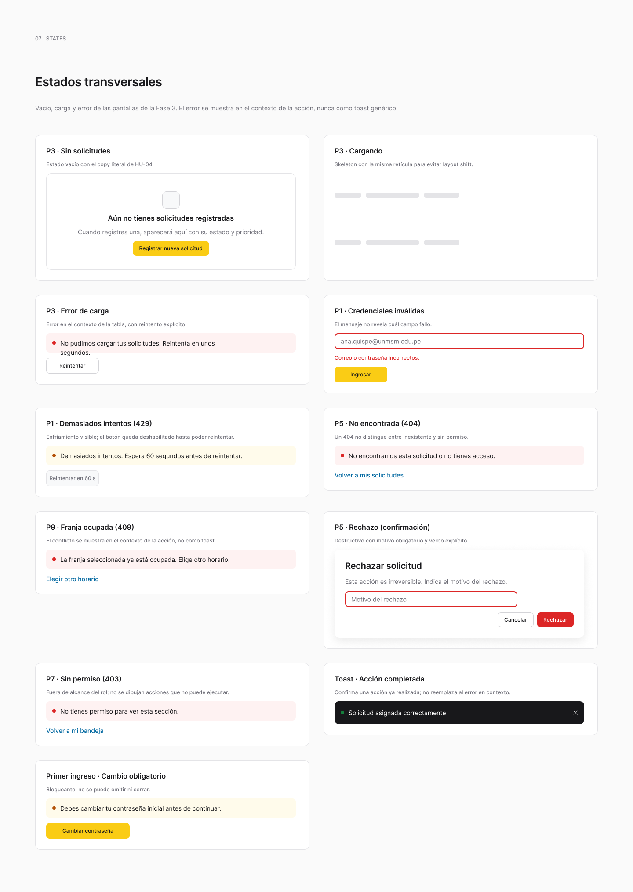

# Fase 01 · Base visual, navegación y API simulada — Plan de implementación

> **Para agentes:** SUB-SKILL OBLIGATORIA: usar superpowers:subagent-driven-development (recomendado) o superpowers:executing-plans para ejecutar este plan tarea por tarea. Los pasos usan casillas (`- [ ]`) para el seguimiento.

**Objetivo:** dejar lista la base compartida (pruebas, lint, tokens, componentes, cliente HTTP, API simulada, router y layouts) sobre la que las fases 02 a 05 implementan las HU-01 a HU-29.

**Arquitectura:** React 19 + Vite 8 en JavaScript. Todo acceso a la API pasa por `src/services/http.js`. En modo simulado, MSW intercepta esas mismas peticiones, así que pantallas y adaptadores son idénticos en ambos modos. Las rutas se cargan bajo demanda por módulo y se protegen por rol (los guardas de sesión llegan en la fase 02).

**Tecnologías:** React 19.3, Vite 8.3, React Router 7, MSW 2, Vitest (versión compatible con Vite 8) con jsdom y Testing Library, ESLint 9 (configuración plana) con `eslint-plugin-react-hooks`.

**Especificación (fuente de verdad):**
- Historias: `../infra-uni/docs/requirements/user-stories/` (HU-01 a HU-29).
- Contrato: `../backend-uni/docs/api/openapi.yaml`, páginas de `../backend-uni/docs/api/` y `../backend-uni/docs/INTEGRACION-FRONTEND.md`.
- Visual: [DESIGN.md](../../../DESIGN.md), [ARCHITECTURE.md](../../../ARCHITECTURE.md), Figma GESTAL-V2 ([componentes](https://www.figma.com/design/9qJJaiyMwZ1ZON36LkmbyR/GESTAL-V2?node-id=17-4), [estados](https://www.figma.com/design/9qJJaiyMwZ1ZON36LkmbyR/GESTAL-V2?node-id=17-9), [handoff](https://www.figma.com/design/9qJJaiyMwZ1ZON36LkmbyR/GESTAL-V2?node-id=17-10)) y la galería al final.
- Versión anterior de este plan (alcance de alto nivel): commit `46f8cf9`.

## Orden de entrega

1. **Base visual y API simulada (este plan).**
2. [Acceso, sesión, registro y perfil](02-acceso-sesion-y-perfil.md).
3. [Solicitudes, evidencias y atención](03-solicitudes-y-atencion.md).
4. [Indicadores y administración](04-indicadores-y-administracion.md).
5. [Reservas y ambientes](05-reservas-y-ambientes.md).
6. [Integración y entrega local](06-integracion-y-entrega-local.md).

Las fases 03, 04 y 05 dependen solo de la 02 y pueden avanzar en paralelo en ramas distintas.

## Restricciones globales (aplican a las seis fases)

- Rama por fase desde `main` (`feature/frontend-fase-0N-...`); nunca confirmar en `main`. PR con título `[frontend] ...`, sin `Co-Authored-By` ni «Generated with Claude Code».
- JavaScript (`.js`/`.jsx`), sin TypeScript. Componentes de función y hooks.
- Prefijo `/api/v1`. IDs siempre como cadenas: nunca `Number(id)`. Paginación `page` desde 0 y `size` 20 por defecto; las respuestas son `{items, page, size, totalElements}`.
- Errores `application/problem+json` con `status`, `codigo`, `detail`, `correlationId` y `errores[] {campo, mensaje}`. Decidir por `status` y `codigo`; mostrar `detail`; asociar `errores[].campo` al campo del formulario; mostrar `correlationId` en errores inesperados.
- Instantes en UTC (ISO 8601) y se muestran en `America/Lima`. Las reservas usan `fecha` `YYYY-MM-DD` y horas `HH:mm` de Lima, sin conversión.
- JWT solo en memoria; nunca `localStorage` ni `sessionStorage` para credenciales.
- Tema claro con los tokens de `DESIGN.md` como variables CSS; sin colores fijos en componentes. Badges siempre con texto.
- Puntos de corte: móvil < 768 px (menú lateral modal, formularios a una columna, filas como tarjetas); escritorio con contenido máximo de 1440 px.
- No inventar endpoints. Lo que el contrato todavía no expone vive solo en `src/services/pendingContract.js` (tarea 5) y se lista en la fase 06 como pendiente de integración.
- Pruebas: `npm test` ejecuta Vitest una sola vez; `npm run lint` sin errores; `npm run build` termina bien.

### Huecos del contrato conocidos (2026-11-13)

| Flujo | Falta en el contrato | Tratamiento en frontend |
| --- | --- | --- |
| Solicitudes | Nombre de prioridad para roles no administradores; marca de encuesta respondida. | Nombre de categoría desde `GET /catalogs/categories`; prioridad y encuesta a través de `pendingContract`. |
| Supervisión | Lectura de prioridades para el selector del supervisor. | `pendingContract.listPriorityOptions()`; en modo real devuelve `null` y la UI oculta el ajuste. |
| Indicadores | Nombres en `porPrioridad` y `porResponsable`. | Categoría por catálogo; prioridad y responsable con texto de respaldo («Prioridad 4», «Responsable 19», `null` → «Sin asignar»). |
| Reservas | Propietario en la bandeja de gestión; nombre del espacio en listados. | Leer `solicitanteId` del detalle al decidir; nombre del espacio desde `GET /spaces`. |

## Foco de revisión

1. **Respuesta tardía de un filtro anterior.** Cambiar de filtro dos veces rápido muestra solo el resultado del último. Prueba `useResource › descarta la respuesta de una petición anterior` (tarea 4).
2. **Error sin cuerpo JSON** (proxy caído, HTML 502). Se muestra un error genérico con reintento, no una excepción de `JSON.parse`. Prueba `http › convierte un 502 HTML en ApiError` (tarea 3).
3. **Doble clic en Guardar.** Solo se envía una petición y el formulario conserva sus datos si falla. Prueba `useSubmit › ignora un segundo envío pendiente` (tarea 4).
4. **Diálogo cerrado con Escape.** El foco vuelve al botón que lo abrió. Prueba `Dialog › devuelve el foco al cerrar con Escape` (tarea 2).
5. **Enlace directo a una ruta de otro rol.** Sin sesión todavía (fase 02), la ruta existe y la tabla de rutas declara sus roles; el guarda de la fase 02 la usa. Prueba `routes › cada ruta autenticada declara roles` (tarea 6).

---

## Estructura de archivos

```text
eslint.config.js                 # ESLint plano
vite.config.js                   # + bloque test de Vitest
src/main.jsx                     # arranque: MSW opcional + RouterProvider
src/test/setup.js                # jest-dom + servidor MSW para Vitest
src/test/render.jsx              # renderWithRouter()
src/styles/tokens.css            # variables CSS de DESIGN.md
src/styles/base.css              # reset, tipografía, foco visible
src/components/ui/*.jsx          # Button, TextField, SelectField, TextArea, Badge, Dialog,
                                 # ConfirmDialog, Skeleton, ErrorState, EmptyState, DataTable, Pagination
src/components/ui/index.js
src/components/layout/AppShell.jsx, Sidebar.jsx, Topbar.jsx, PublicLayout.jsx
src/services/apiError.js         # ApiError y parseo de problem+json
src/services/http.js             # request(), configureHttp()
src/services/useResource.js      # lecturas con descarte de respuestas obsoletas
src/services/useSubmit.js        # escrituras con bloqueo de envío pendiente
src/services/format.js           # fechas Lima, tamaños, etiquetas de códigos
src/services/download.js         # downloadBlob() para CSV y evidencias
src/services/catalogs.js         # categorías habilitadas y nombres de catálogo
src/services/pendingContract.js  # único lugar para huecos del contrato
src/features/home/HomePage.jsx   # inicio por rol con secciones que llena cada fase
src/features/home/RequestsPreview.jsx, AdminShortcuts.jsx, ReservationsPreview.jsx
src/mocks/db.js                  # datos ficticios deterministas
src/mocks/handlers/index.js      # agrega handlers por feature
src/mocks/browser.js, server.js
src/app/routes.jsx               # tabla de rutas {path, roles, lazy}
src/app/navigation.js            # menú por rol
src/app/router.jsx               # createAppRouter()
```

`src/App.jsx` y `src/styles.css` se eliminan en la tarea 6 (la pantalla de estado del entorno se reemplaza por el router).

---

### Tarea 1: Herramientas de prueba y lint

**Archivos:**
- Modificar: `package.json`, `vite.config.js`
- Crear: `eslint.config.js`, `src/test/setup.js`, `src/test/smoke.test.jsx`

**Interfaces:**
- Produce: scripts `test` (`vitest run`), `test:watch`, `lint` (`eslint .`), `dev:mock` (`vite --mode mock`); entorno `jsdom`; `globals: true`; `setupFiles: ['src/test/setup.js']`.

- [ ] **Paso 1: Crear la rama e instalar dependencias**

```bash
git switch main && git pull && git switch -c feature/frontend-fase-01-base
npm i react-router@7 && npm i -D vitest jsdom @testing-library/react @testing-library/user-event @testing-library/jest-dom msw@2 eslint@9 @eslint/js globals eslint-plugin-react-hooks
```

Expected: `npm` termina sin `ERESOLVE`. Si Vitest no admite Vite 8, instalar la versión mayor que lo declare en `peerDependencies` y anotarlo en el ledger.

- [ ] **Paso 2: Escribir la prueba de humo**

```jsx
// src/test/smoke.test.jsx
import { render, screen } from '@testing-library/react';
test('renderiza en jsdom con jest-dom', () => {
  render(<h1>Hola</h1>);
  expect(screen.getByRole('heading', { name: 'Hola' })).toBeInTheDocument();
});
```

- [ ] **Paso 3: Ejecutarla sin configuración**

Run: `npx vitest run src/test/smoke.test.jsx`
Expected: FAIL (`document is not defined` o `toBeInTheDocument is not a function`).

- [ ] **Paso 4: Configurar Vitest, setup y ESLint**

En `vite.config.js` añadir `test: { environment: 'jsdom', globals: true, setupFiles: ['src/test/setup.js'], css: false }`. `src/test/setup.js` importa `@testing-library/jest-dom/vitest`. `eslint.config.js`: `@eslint/js` recomendado + `react-hooks` recomendado, `globals.browser`, ignora `dist/` y `public/mockServiceWorker.js`. Añadir los scripts de la sección Interfaces.

- [ ] **Paso 5: Verificar**

Run: `npm test && npm run lint && npm run build`
Expected: `1 passed`; lint sin errores; build sin errores.

- [ ] **Paso 6: Commit**

```bash
git add package.json package-lock.json vite.config.js eslint.config.js src/test
git commit -m "chore(frontend): configurar Vitest, Testing Library, MSW y ESLint"
```

---

### Tarea 2: Tokens y componentes comunes

**Archivos:**
- Crear: `src/styles/tokens.css`, `src/styles/base.css`, `src/components/ui/*.jsx`, `src/components/ui/index.js`
- Prueba: `src/components/ui/ui.test.jsx`

**Interfaces:**
- Produce (exportados desde `src/components/ui/index.js`):
  - `Button({variant='primary'|'secondary'|'danger'|'ghost', pending=false, ...buttonProps})`: con `pending` queda `disabled` y `aria-busy="true"`.
  - `TextField({label, name, error, hint, ...inputProps})`, `TextArea(...)`, `SelectField({label, name, options:[{value,label}], placeholder, error})`: etiqueta visible enlazada por `id`; con `error`, `aria-invalid="true"` y `aria-describedby` hacia el mensaje.
  - `Badge({tone='neutral'|'info'|'success'|'warning'|'danger', children})`.
  - `Dialog({open, title, onClose, children, footer})`: `<dialog>` modal; Escape llama a `onClose`; al cerrar devuelve el foco al elemento activo previo.
  - `ConfirmDialog({open, title, message, confirmLabel, tone, pending, onConfirm, onCancel, children})`.
  - `Skeleton({lines=3})`, `EmptyState({title, description, action})`, `ErrorState({error, onRetry})`: muestra `error.detail` o «No se pudo completar la operación.», y `Código de rastreo: <correlationId>` si existe; botón «Reintentar» solo con `onRetry`.
  - `DataTable({columns:[{key,header,render?}], rows, getRowKey, onRowClick?, caption})`: `<table>` en escritorio; en móvil la misma tabla con CSS `data-label` por celda (tarjetas etiquetadas).
  - `Pagination({page, size, totalElements, onChange})`: «Anterior»/«Siguiente», texto «Página N de M».

- [ ] **Paso 1: Escribir las pruebas**

```jsx
// src/components/ui/ui.test.jsx
test('TextField enlaza etiqueta y error', ...) // getByLabelText('Correo') tiene aria-invalid="true" y accesible description 'Obligatorio'
test('Button pending queda deshabilitado y ocupado', ...) // disabled + aria-busy="true"
test('Dialog devuelve el foco al cerrar con Escape', async () => {
  // botón «Abrir» abre Dialog; user.keyboard('{Escape}'); onClose llamado; expect(abrir).toHaveFocus()
});
test('ErrorState muestra detail, código de rastreo y reintento', ...) // texto 'Código de rastreo: abc'; click «Reintentar» llama onRetry
test('ErrorState sin onRetry no muestra el botón', ...)
test('DataTable añade data-label con el encabezado a cada celda', ...)
test('Pagination calcula páginas y deshabilita extremos', ...) // page 0, size 20, total 41 → 'Página 1 de 3', «Anterior» disabled; click «Siguiente» → onChange(1)
```

jsdom no implementa `HTMLDialogElement.showModal`: en `src/test/setup.js` definir `showModal`/`close` mínimos que alternan el atributo `open` y disparan `close`.

- [ ] **Paso 2: Ejecutar**

Run: `npm test -- src/components/ui`
Expected: FAIL (`Failed to resolve import "./index.js"`).

- [ ] **Paso 3: Implementar tokens y componentes**

`tokens.css` define en `:root` `--color-primary: #FACC15`, `--color-ink: #18181B`, `--color-ink-muted: #71717A`, `--color-bg: #FAFAFA`, `--color-surface: #FFFFFF`, `--color-surface-variant: #F8F9FA`, `--color-border: #E4E4E7`, `--color-error: #DC2626`, `--color-success: #15803D`, `--color-warning: #B45309`, `--color-info: #0369A1`, radios `4/8/12/999px`, espaciado `4/8/16/24/32px`, fuente Inter 14px/1.5. `base.css`: `:focus-visible` con contorno de 2px `--color-ink`, `font-variant-numeric: tabular-nums` en tablas. Los componentes usan clases BEM simples y solo variables.

- [ ] **Paso 4: Verificar**

Run: `npm test -- src/components/ui && npm run lint`
Expected: 7 passed; lint sin errores.

- [ ] **Paso 5: Commit**

```bash
git add src/styles src/components/ui src/test/setup.js
git commit -m "feat(frontend): tokens de DESIGN.md y componentes comunes accesibles"
```

---

### Tarea 3: Cliente HTTP y errores normalizados

**Archivos:**
- Crear: `src/services/apiError.js`, `src/services/http.js`
- Prueba: `src/services/http.test.js`

**Interfaces:**
- Produce:
  - `class ApiError extends Error { kind: 'network'|'http'; status: number|null; codigo: string|null; detail: string; fieldErrors: Record<string,string>; correlationId: string|null }`.
  - `request(path, { method='GET', query, body, formData, signal, responseType='json'|'blob', auth=true, retryOnUnauthorized=true } = {}) -> Promise<any>`:
    - URL = `/api/v1` + `path` + query sin claves `undefined`, `null` ni `''`.
    - `body` → JSON con `Content-Type: application/json`; `formData` → multipart sin fijar `Content-Type`.
    - `204` → `null`; `responseType: 'blob'` → `{ blob, filename }` (de `Content-Disposition`, admite `filename*=UTF-8''...`).
    - No-2xx → lanza `ApiError` (`problem+json` si el tipo lo indica; si no, `detail` genérico y `correlationId` desde `X-Correlation-ID`).
    - `fetch` rechazado (no `AbortError`) → `ApiError{kind:'network', detail:'No hay conexión con el servidor.'}`. `AbortError` se relanza tal cual.
  - `configureHttp({ getAccessToken, renewSession, onProblem })`: con `auth` y token, añade `Authorization: Bearer`. Ante `401` con `retryOnUnauthorized` y `renewSession`, espera `renewSession()`; si devuelve `true`, repite una vez la petición con el token nuevo. `onProblem(apiError)` se llama para todo error HTTP (la fase 02 lo usa para `CAMBIO_CONTRASENA_REQUERIDO`).
  - `isAbort(error) -> boolean`.

- [ ] **Paso 1: Escribir las pruebas** (MSW `server.use` por prueba; el servidor se crea en la tarea 5, aquí usar `vi.spyOn(globalThis, 'fetch')`)

```js
test('arma la URL con prefijo y omite query vacía', ...) // request('/requests', {query:{page:0,size:20,estado:''}}) → '/api/v1/requests?page=0&size=20'
test('envía JSON y devuelve el cuerpo', ...)
test('204 devuelve null', ...)
test('normaliza problem+json con errores de campo', ...)
// 400 {codigo:'VALIDACION', detail:'Datos inválidos', correlationId:'c1', errores:[{campo:'correo',mensaje:'Obligatorio'}]}
// → ApiError{status:400, codigo:'VALIDACION', fieldErrors:{correo:'Obligatorio'}, correlationId:'c1'}
test('convierte un 502 HTML en ApiError', ...) // text/html → kind 'http', status 502, detail 'No se pudo completar la operación.'
test('fallo de red produce kind network', ...)
test('blob lee filename de Content-Disposition', ...) // 'attachment; filename="solicitudes.csv"' → filename 'solicitudes.csv'
test('añade Bearer y reintenta una vez tras renovar', ...) // 1.ª 401, renewSession→true, 2.ª 200 con token nuevo; fetch llamado 2 veces
test('no reintenta con retryOnUnauthorized false', ...)
test('no reintenta dos veces si vuelve 401', ...) // renewSession llamado 1 vez; lanza ApiError 401
test('notifica onProblem con el ApiError', ...)
```

- [ ] **Paso 2: Ejecutar**

Run: `npm test -- src/services/http.test.js`
Expected: FAIL (módulo inexistente).

- [ ] **Paso 3: Implementar `apiError.js` y `http.js`** según la sección Interfaces.

- [ ] **Paso 4: Verificar**

Run: `npm test -- src/services/http.test.js`
Expected: 11 passed.

- [ ] **Paso 5: Commit**

```bash
git add src/services/apiError.js src/services/http.js src/services/http.test.js
git commit -m "feat(frontend): cliente HTTP central con problem+json y reintento tras renovar"
```

---

### Tarea 4: Lecturas, escrituras y formato

**Archivos:**
- Crear: `src/services/useResource.js`, `src/services/useSubmit.js`, `src/services/format.js`, `src/services/download.js`
- Prueba: `src/services/useResource.test.jsx`, `src/services/useSubmit.test.jsx`, `src/services/format.test.js`, `src/services/download.test.js`

**Interfaces:**
- Consume: `request`, `isAbort`, `ApiError` (tarea 3).
- Produce:
  - `useResource(loader: (signal) => Promise<T>, deps: any[]) -> { data: T|undefined, error: ApiError|null, status: 'loading'|'success'|'error', reload: () => void, setData }`: aborta la petición anterior al cambiar `deps` y descarta cualquier resultado que no corresponda a la última petición.
  - `useSubmit(action: (...args) => Promise<T>) -> { submit(...args): Promise<T|undefined>, pending: boolean, error: ApiError|null, fieldErrors: Record<string,string>, reset() }`: mientras `pending`, una segunda llamada devuelve `undefined` sin ejecutar `action`. No toca los valores del formulario.
  - `format.js`: `formatDateTime(isoUtc) -> 'dd/mm/aaaa hh:mm'` en `America/Lima`; `formatDate(isoUtc)`; `todayInLima() -> 'YYYY-MM-DD'`; `limaDaysToUtcRange(desde, hasta) -> {fechaDesde, fechaHasta}` (inicio inclusivo a las 00:00 de Lima del día `desde`, fin exclusivo a las 00:00 del día siguiente a `hasta`; Lima es UTC−5 sin horario de verano); `currentMonthInLima() -> {desde, hasta}`; `formatBytes(n)`; `REQUEST_STATUS_LABELS` (`NUEVO` Nuevo, `ASIGNADO` Asignado, `EN_PROCESO` En proceso, `RESUELTO` Resuelto, `CERRADO` Cerrado, `RECHAZADO` Rechazado); `RESERVATION_STATUS_LABELS` (`PENDIENTE` Pendiente, `CONFIRMADA` Confirmada, `RECHAZADA` Rechazada, `CANCELADA` Cancelada); `ROLE_LABELS` (`ESTUDIANTE` Estudiante, `DOCENTE` Docente, `TECNICO` Técnico, `SUPERVISOR` Supervisor, `ADMINISTRADOR` Administrador); `statusTone(code) -> tone de Badge`.
  - `downloadBlob({ blob, filename })` en `download.js`: crea un `objectURL`, hace clic en un `<a download>` temporal y revoca la URL. Lo usan los CSV (fase 04) y las evidencias (fase 03).

- [ ] **Paso 1: Escribir las pruebas**

```jsx
test('useResource descarta la respuesta de una petición anterior', async () => {
  // loader(filtro) resuelve 'A' tras 50 ms y 'B' tras 10 ms; rerender con filtro B antes de que A termine
  // → data final 'B' y nunca 'A'
});
test('useResource expone error y recupera con reload', ...)
test('useSubmit ignora un segundo envío pendiente', ...) // action llamada 1 vez con dos submit seguidos
test('useSubmit expone fieldErrors del ApiError', ...)
test('limaDaysToUtcRange convierte días de Lima a UTC con fin exclusivo', () => {
  expect(limaDaysToUtcRange('2026-11-01', '2026-11-30'))
    .toEqual({ fechaDesde: '2026-11-01T05:00:00Z', fechaHasta: '2026-12-01T05:00:00Z' });
});
test('formatDateTime muestra hora de Lima', () => {
  expect(formatDateTime('2026-11-06T15:00:00Z')).toBe('06/11/2026 10:00');
});
test('formatBytes', () => { expect(formatBytes(2097152)).toBe('2 MB'); expect(formatBytes(1536)).toBe('1.5 KB'); });
test('downloadBlob usa el nombre y revoca la URL', ...) // spy en URL.createObjectURL/revokeObjectURL; el <a> tiene download='solicitudes.csv'
```

- [ ] **Paso 2: Ejecutar**

Run: `npm test -- src/services`
Expected: FAIL en los tres archivos nuevos.

- [ ] **Paso 3: Implementar** con `Intl.DateTimeFormat('es-PE', { timeZone: 'America/Lima', ... })`.

- [ ] **Paso 4: Verificar**

Run: `npm test -- src/services`
Expected: todo en verde (incluidas las 11 de la tarea 3).

- [ ] **Paso 5: Commit**

```bash
git add src/services
git commit -m "feat(frontend): hooks de lectura y escritura y formato en hora de Lima"
```

---

### Tarea 5: API simulada con MSW

**Archivos:**
- Crear: `src/mocks/db.js`, `src/mocks/handlers/index.js`, `src/mocks/handlers/status.js`, `src/mocks/handlers/catalogs.js`, `src/mocks/browser.js`, `src/mocks/server.js`, `src/services/pendingContract.js`, `src/services/catalogs.js`, `.env.mock`
- Modificar: `src/test/setup.js`, `src/main.jsx`
- Generar: `public/mockServiceWorker.js` (`npx msw init public --save`)
- Prueba: `src/mocks/mocks.test.js`

**Interfaces:**
- Produce:
  - `db` con usuarios de demostración que replican `INTEGRACION-FRONTEND.md` (mismos correos, roles y áreas; contraseña `Demo2026!`), más categorías, prioridades, áreas y estados. IDs como cadenas. `resetDb()` restaura el estado inicial (se llama en `afterEach`).
  - `handlers` = arreglo agregado; cada fase añade su archivo en `src/mocks/handlers/` y lo registra en `index.js`.
  - Utilidades para handlers: `problem(status, codigo, detail, errores?) -> HttpResponse` y `paginate(items, url) -> {items,page,size,totalElements}`.
  - `server` (`msw/node`) usado en `setup.js` con `onUnhandledRequest: 'error'`.
  - Arranque: si `import.meta.env.VITE_API_MODE === 'mock'`, `main.jsx` espera `worker.start({ onUnhandledRequest: 'warn' })` antes de renderizar. `.env.mock` contiene `VITE_API_MODE=mock`.
  - `pendingContract.js`: `isMockMode()`, `listPriorityOptions() -> Promise<[{id,nombre}]|null>`, `priorityName(id) -> string` («Prioridad <id>» en modo real), `surveyAnswered(request) -> boolean|null` (lee `request.encuestaRespondida` si existe; si no, `null`). En modo simulado devuelve los datos de `db`.
  - `catalogs.js`: `listEnabledCategories() -> Promise<[{id, nombre}]>` (`GET /catalogs/categories?size=100`, devuelve `items`) y `useCatalogLabels() -> { categoryName(id), priorityName(id), categories, ready }`; categoría desconocida → «Categoría <id>»; prioridad vía `pendingContract.priorityName`. Lo usan las fases 03 y 04.
  - Handler de `GET /api/v1/catalogs/categories` con las categorías activas de `db`. En esta fase no exige sesión; la fase 02 añade la comprobación del Bearer a todos los handlers protegidos.

- [ ] **Paso 1: Escribir las pruebas**

```js
test('useCatalogLabels resuelve categoría y usa respaldo para desconocidas', ...) // categoryName('3') 'Conectividad'; categoryName('999') 'Categoría 999'
test('GET /api/v1/status responde UP desde el mock', async () => {
  expect(await request('/status', { auth: false })).toEqual({ status: 'UP' });
});
test('problem() produce problem+json que request convierte en ApiError', ...)
test('paginate respeta page y size', ...) // 45 ítems, page=2&size=20 → 5 ítems, totalElements 45
test('resetDb restaura los datos', ...)
test('una petición sin handler falla la prueba', ...) // expect(request('/no-existe')).rejects
```

- [ ] **Paso 2: Ejecutar**

Run: `npm test -- src/mocks`
Expected: FAIL (módulos inexistentes).

- [ ] **Paso 3: Implementar** según Interfaces. `setup.js`: `beforeAll(server.listen)`, `afterEach(() => { server.resetHandlers(); resetDb(); })`, `afterAll(server.close)`.

- [ ] **Paso 4: Verificar**

Run: `npm test && npm run dev:mock` (abrir `http://localhost:3000`, ver en consola «[MSW] Mocking enabled», detener)
Expected: todo en verde; MSW activo solo con `dev:mock`.

- [ ] **Paso 5: Commit**

```bash
git add src/mocks src/services/pendingContract.js src/services/catalogs.js src/test/setup.js src/main.jsx public/mockServiceWorker.js .env.mock package.json
git commit -m "feat(frontend): API simulada con MSW sobre el mismo cliente HTTP"
```

---

### Tarea 6: Router, layouts y navegación por rol

**Archivos:**
- Crear: `src/app/routes.jsx`, `src/app/navigation.js`, `src/app/router.jsx`, `src/components/layout/AppShell.jsx`, `Sidebar.jsx`, `Topbar.jsx`, `PublicLayout.jsx`, `src/app/NotFoundPage.jsx`, `src/app/PlaceholderPage.jsx`, `src/test/render.jsx`, `src/features/home/HomePage.jsx`, `RequestsPreview.jsx`, `AdminShortcuts.jsx`, `ReservationsPreview.jsx`, `src/features/home/index.js`
- Modificar: `src/main.jsx`
- Eliminar: `src/App.jsx`, `src/styles.css`
- Prueba: `src/app/routes.test.js`, `src/components/layout/layout.test.jsx`

**Interfaces:**
- Produce:
  - `ROUTES`: arreglo `{ path, roles: string[]|null, lazy: () => import(...), title }`. `roles: null` = pública. Rutas iniciales (con `PlaceholderPage` hasta su fase): `/login`, `/registro`, `/cambiar-contrasena` (públicas o de sesión restringida), `/inicio`, `/perfil`, `/solicitudes`, `/solicitudes/nueva`, `/solicitudes/:id`, `/bandeja`, `/gestion`, `/indicadores`, `/reservas`, `/reservas/nueva`, `/reservas/:id`, `/reservas/aprobacion`, `/admin/usuarios`, `/admin/catalogos`, `/admin/sla`, `/admin/ambientes`.
  - Roles por ruta: solicitudes propias `ESTUDIANTE`, `DOCENTE`; `/solicitudes/:id` además `TECNICO`, `SUPERVISOR`; `/bandeja` `TECNICO`; `/gestion` `SUPERVISOR`; `/indicadores` `SUPERVISOR`, `ADMINISTRADOR`; `/reservas`, `/reservas/nueva`, `/reservas/:id` todos los roles; `/reservas/aprobacion` `SUPERVISOR`, `ADMINISTRADOR`; `/admin/*` `ADMINISTRADOR`; `/inicio` `ESTUDIANTE`, `DOCENTE`, `TECNICO`, `ADMINISTRADOR`; `/perfil` todos.
  - `navigationFor(rol) -> [{ to, label }]` en el orden del sidebar de Figma.
  - `createAppRouter({ routes = ROUTES, guard } = {})`: `guard` es un componente opcional que envuelve las rutas autenticadas (la fase 02 pasa `RequireRole`).
  - `AppShell({ user, onLogout, children })`: sidebar de 224 px con navegación, topbar de 60 px con nombre y rol; por debajo de 768 px un botón «Abrir menú» abre el sidebar como `Dialog`.
  - `renderWithRouter(ui|null, { route='/', routes, user })` para pruebas.
  - `HomePage({ user })` en `/inicio`: saludo con el nombre y, según el rol, `RequestsPreview` (`ESTUDIANTE`, `DOCENTE`, `TECNICO`; lo llena la fase 03), `AdminShortcuts` (`ADMINISTRADOR`; fase 04) y `ReservationsPreview` (`ESTUDIANTE`, `DOCENTE`, `TECNICO`; fase 05). Las tres secciones nacen aquí devolviendo `null`, para que las fases 03 a 05 editen cada una su propio archivo sin chocar.

- [ ] **Paso 1: Escribir las pruebas**

```js
test('cada ruta autenticada declara roles', () => {
  ROUTES.filter(r => !['/login', '/registro', '/cambiar-contrasena'].includes(r.path))
    .forEach(r => expect(r.roles?.length).toBeGreaterThan(0));
});
test('navigationFor(ESTUDIANTE) y DOCENTE son iguales', ...)
test('navigationFor(ADMINISTRADOR) incluye Usuarios, Catálogos, SLA, Ambientes e Indicadores', ...)
test('navigationFor(TECNICO) no incluye Gestión ni Administración', ...)
test('AppShell marca la ruta activa con aria-current', ...)
test('en móvil el menú se abre como diálogo y devuelve el foco', ...) // window.matchMedia simulado a (max-width: 767px)
test('ruta desconocida muestra NotFoundPage', ...)
test('HomePage elige las secciones por rol', ...) // vi.mock de las tres secciones; ADMINISTRADOR solo AdminShortcuts; TECNICO RequestsPreview y ReservationsPreview
```

- [ ] **Paso 2: Ejecutar**

Run: `npm test -- src/app src/components/layout`
Expected: FAIL.

- [ ] **Paso 3: Implementar** con `createBrowserRouter` y `lazy` de React Router 7 (un import dinámico por feature). Eliminar `App.jsx` y `styles.css`; `main.jsx` importa `tokens.css` y `base.css`.

- [ ] **Paso 4: Verificar**

Run: `npm test && npm run lint && npm run build`
Expected: todo en verde; el build genera un chunk por feature (ver `dist/assets/` con varios `.js`).

- [ ] **Paso 5: Verificación visual**

Run: `npm run dev:mock` y revisar `/inicio` y `/perfil` a 360, 768 y 1440 px.
Expected: sidebar y topbar a 1440; menú modal a 360; sin desplazamiento horizontal.

- [ ] **Paso 6: Commit**

```bash
git add -A src package.json
git commit -m "feat(frontend): router con rutas por rol, layouts y navegación adaptable"
```

---

## Aceptación de la fase

- [ ] `npm test`, `npm run lint` y `npm run build` en verde.
- [ ] Navegación, diálogos, carga, vacío, error y reintento revisados a 360, 768 y 1440 px.
- [ ] El modo simulado y el real usan los mismos adaptadores (`request`); solo `pendingContract.js` distingue el modo.

## Capturas de Figma

<details>
<summary>Estados transversales</summary>



[Ver frame en Figma](https://www.figma.com/design/9qJJaiyMwZ1ZON36LkmbyR/GESTAL-V2?node-id=56-2)

</details>
