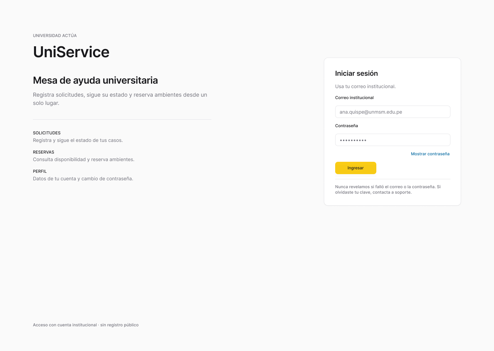
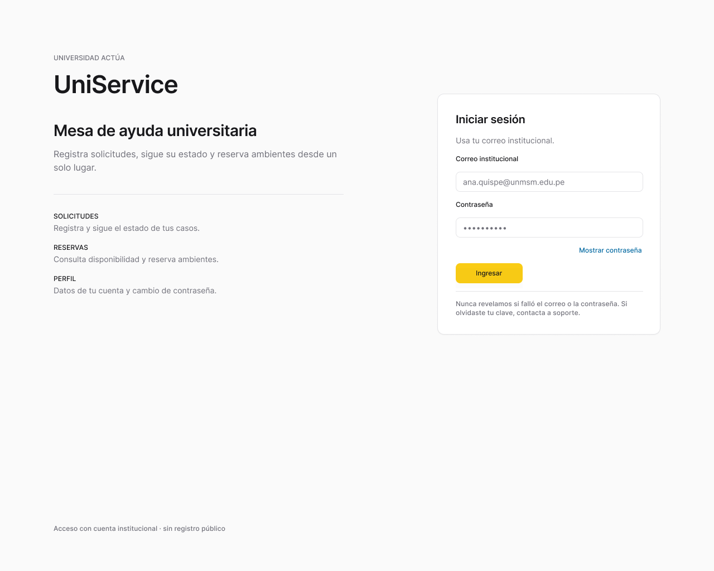
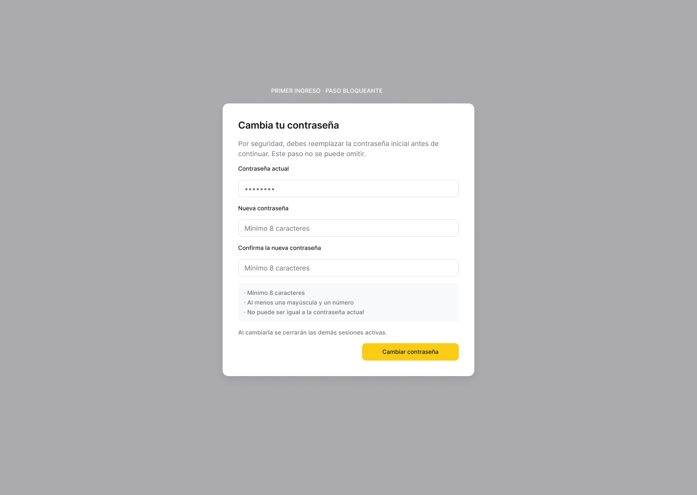
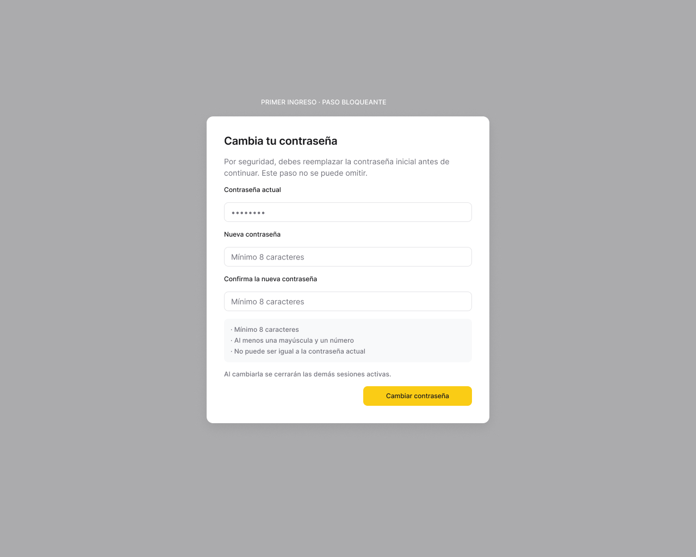
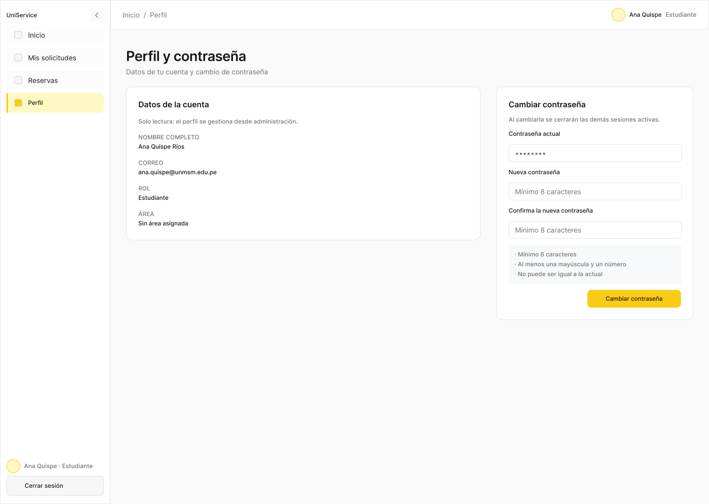
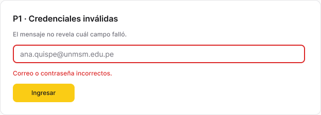
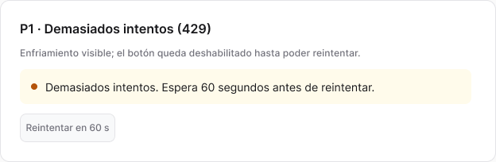

# Fase 02 · Acceso, sesión, registro y perfil — Plan de implementación

> **Para agentes:** SUB-SKILL OBLIGATORIA: usar superpowers:subagent-driven-development (recomendado) o superpowers:executing-plans para ejecutar este plan tarea por tarea. Los pasos usan casillas (`- [ ]`) para el seguimiento.

**Objetivo:** implementar ingreso, restauración y renovación de sesión, primer ingreso, perfil con cambio de contraseña, cierre de sesión, acceso por rol y auto-registro de estudiantes (HU-01, HU-02, HU-27 y el CA-05 de HU-29).

**Arquitectura:** un `SessionProvider` guarda el JWT y el usuario en memoria y configura `http.js` (`configureHttp`). La renovación se coordina con una sola petición en vuelo por pestaña y un Web Lock entre pestañas, porque reutilizar una cookie ya rotada revoca la sesión. Un contador de época invalida las respuestas que llegan después de cerrar sesión. Los guardas `RequireSession` y `RequireRole` usan la tabla `ROUTES` de la fase 01.

**Tecnologías:** las de la fase 01; Web Locks API (`navigator.locks`).

**Especificación:**
- HU-01, HU-02 y HU-27 en `../infra-uni/docs/requirements/user-stories/EP-01-Autenticacion/`; HU-29 CA-05.
- `../backend-uni/docs/api/autenticacion.md` y la sección «Sesión» de `../backend-uni/docs/INTEGRACION-FRONTEND.md`.
- Figma: [P01 Ingreso](https://www.figma.com/design/9qJJaiyMwZ1ZON36LkmbyR/GESTAL-V2?node-id=47-2), [P02 Primer ingreso](https://www.figma.com/design/9qJJaiyMwZ1ZON36LkmbyR/GESTAL-V2?node-id=47-80), [P16 Perfil](https://www.figma.com/design/9qJJaiyMwZ1ZON36LkmbyR/GESTAL-V2?node-id=74-549). El registro (HU-27) no tiene frame: reutilizar la composición de P01.
- Depende de la [fase 01](01-base-visual-y-api-simulada.md). Versión anterior: commit `46f8cf9`.

## Restricciones globales

Rigen las de la [fase 01](01-base-visual-y-api-simulada.md#restricciones-globales-aplican-a-las-seis-fases). Además:

- Respuesta de sesión (`login`, `refresh`, `PATCH /auth/password`): `{ tokenAcceso, expiraEnSegundos, usuario: { id, nombreCompleto, rol, areaId }, debeCambiarContrasena }`.
- Las operaciones `/auth/*` usan `retryOnUnauthorized: false`. `login`, `register` y `refresh` usan `auth: false`.
- No fijar `Origin` a mano; la cookie viaja sola en mismo origen.
- Destino tras ingresar: `SUPERVISOR` → `/indicadores`; los demás → `/inicio`. Con `debeCambiarContrasena: true` → `/cambiar-contrasena`.
- Política de contraseña: de 8 a 72 caracteres, con al menos una letra y un dígito.
- Dominio del registro: termina exactamente en `@unmsm.edu.pe`, sin distinguir mayúsculas y tras recortar espacios.
- Textos fijos:
  - 401 en ingreso: «Correo o contraseña incorrectos».
  - 429 en ingreso: «Demasiados intentos. Espera unos minutos e inténtalo de nuevo.»
  - `403 CUENTA_PENDIENTE`: «Tu cuenta está pendiente de aprobación por un administrador.»
  - `403 CUENTA_RECHAZADA`: «Tu cuenta fue rechazada. Comunícate con la administración.»
  - Registro correcto: «Registro enviado. Podrás ingresar cuando un administrador apruebe tu cuenta» (texto exacto de HU-27 CA-05).
  - `409 CORREO_REGISTRADO`: «Este correo ya está registrado.»
  - Logout con fallo de red: «No se pudo confirmar el cierre de sesión. Reintenta para revocarla en el servidor.»

## Foco de revisión

1. **Dos pestañas renuevan a la vez.** Solo una petición `POST /auth/refresh` a la vez; la segunda pestaña usa la cookie ya rotada sin reutilizar la anterior. Prueba `refreshCoordinator › serializa con Web Locks` (tarea 2).
2. **Respuesta tardía después de cerrar sesión.** Una lectura que termina tras el logout no repuebla datos ni restaura la sesión. Prueba `SessionProvider › ignora una renovación que termina después del logout` (tarea 3).
3. **Navegador sin Web Locks** (Safari antiguo, contexto inseguro). La renovación sigue funcionando con la deduplicación por pestaña. Prueba `refreshCoordinator › funciona sin navigator.locks` (tarea 2).
4. **Enlace directo a una ruta de otro rol** (por ejemplo, un técnico abre `/admin/usuarios`). Se muestra «No tienes permiso para ver esta página» con enlace a su inicio, sin pedir datos al servidor. Prueba `RequireRole › bloquea un rol no autorizado` (tarea 4).
5. **Sesión de primer ingreso que intenta una operación de negocio.** Un `403 CAMBIO_CONTRASENA_REQUERIDO` de cualquier petición lleva a `/cambiar-contrasena`. Prueba `SessionProvider › redirige ante CAMBIO_CONTRASENA_REQUERIDO` (tarea 3).

---

## Estructura de archivos

```text
src/features/auth/authApi.js            # login, refresh, logout, changePassword, register
src/features/auth/refreshCoordinator.js # una renovación por pestaña + Web Lock
src/features/auth/SessionProvider.jsx   # estado de sesión y configureHttp
src/features/auth/guards.jsx            # RequireSession, RequireRole, homePathFor
src/features/auth/passwordPolicy.js     # validatePassword, isInstitutionalEmail
src/features/auth/LoginPage.jsx
src/features/auth/RegisterPage.jsx
src/features/auth/ChangePasswordPage.jsx
src/features/auth/ProfilePage.jsx
src/features/auth/PasswordForm.jsx      # compartido por cambio obligatorio y perfil
src/mocks/handlers/auth.js
```

---

### Task 1: Adaptador de autenticación y mocks

**Archivos:**
- Crear: `src/features/auth/authApi.js`, `src/features/auth/passwordPolicy.js`, `src/mocks/handlers/auth.js`
- Modificar: `src/mocks/handlers/index.js`, `src/mocks/db.js`, `src/mocks/handlers/catalogs.js`
- Prueba: `src/features/auth/authApi.test.js`, `src/features/auth/passwordPolicy.test.js`

**Interfaces:**
- Consume: `request` (fase 01, tarea 3), `db`, `problem` (fase 01, tarea 5).
- Produce:
  - `login({ correo, contrasena }) -> Promise<AuthResponse>`, `refresh() -> Promise<AuthResponse>`, `logout() -> Promise<null>`, `changePassword({ contrasenaActual, contrasenaNueva }) -> Promise<AuthResponse>`, `register({ nombreCompleto, correo, contrasena, confirmacionContrasena }) -> Promise<{ mensaje }>`.
  - `validatePassword(value) -> string|null` (mensaje o `null`); `isInstitutionalEmail(value) -> boolean`.
  - Utilidad de mocks `requireUser(request, roles?) -> user | HttpResponse` en `src/mocks/db.js`: sin Bearer válido → 401; sesión de primer ingreso → 403 `CAMBIO_CONTRASENA_REQUERIDO`; rol fuera de `roles` → 403. Se aplica al handler de categorías de la fase 01 y la usan los handlers de las fases 03 a 05.
  - Mock: el refresh token se modela como una cookie simulada en memoria del handler (`db.sessions`), con rotación y revocación por reúso; `login` responde 401 con contraseña errónea, 429 tras 5 fallos seguidos del mismo correo, 403 `CUENTA_PENDIENTE`/`CUENTA_RECHAZADA` para cuentas en esos estados con la contraseña correcta; usuario `nuevo.demo@universidad.example` con `debeCambiarContrasena: true`; `PATCH /auth/password` con actual errónea → 400 `VALIDACION` y `errores[0].campo = 'contrasenaActual'`; `register` con dominio distinto → 400 con campo `correo`, correo existente → 409 `CORREO_REGISTRADO`.

- [ ] **Paso 1: Crear la rama y escribir las pruebas**

```bash
git switch main && git pull && git switch -c feature/frontend-fase-02-sesion
```

```js
test('login válido devuelve tokenAcceso y usuario', ...) // ana.demo / Demo2026! → usuario.rol 'ESTUDIANTE', usuario.id es string
test('login inválido lanza ApiError 401', ...)
test('login de cuenta pendiente lanza 403 CUENTA_PENDIENTE', ...)
test('changePassword con actual errónea marca contrasenaActual', ...) // fieldErrors.contrasenaActual definido
test('register con dominio distinto devuelve error en correo', ...)
test('register con correo existente devuelve 409 CORREO_REGISTRADO', ...)
test('login no envía Authorization', ...) // inspeccionar request en el handler
test('requireUser protege categorías', ...) // GET /catalogs/categories sin token → 401; con sesión de primer ingreso → 403 CAMBIO_CONTRASENA_REQUERIDO
test('validatePassword', () => {
  expect(validatePassword('abc12')).toMatch(/8/);
  expect(validatePassword('abcdefgh')).toMatch(/dígito/);
  expect(validatePassword('12345678')).toMatch(/letra/);
  expect(validatePassword('a1'.repeat(37))).toMatch(/72/);
  expect(validatePassword('clave2026')).toBeNull();
});
test('isInstitutionalEmail', () => {
  expect(isInstitutionalEmail(' Lucia@UNMSM.edu.pe ')).toBe(true);
  expect(isInstitutionalEmail('lucia@fisi.unmsm.edu.pe')).toBe(false);
  expect(isInstitutionalEmail('lucia@unmsm.edu.pe.com')).toBe(false);
});
```

- [ ] **Paso 2: Ejecutar**

Run: `npm test -- src/features/auth`
Expected: FAIL (módulos inexistentes).

- [ ] **Paso 3: Implementar** `authApi.js`, `passwordPolicy.js` y `handlers/auth.js` según Interfaces.

- [ ] **Paso 4: Verificar**

Run: `npm test -- src/features/auth`
Expected: 10 passed.

- [ ] **Paso 5: Commit**

```bash
git add src/features/auth src/mocks/handlers
git commit -m "feat(frontend): adaptador de autenticación, política de contraseña y mocks de sesión"
```

---

### Task 2: Coordinador de renovación

**Archivos:**
- Crear: `src/features/auth/refreshCoordinator.js`
- Prueba: `src/features/auth/refreshCoordinator.test.js`

**Interfaces:**
- Produce: `createRefreshCoordinator({ doRefresh: () => Promise<AuthResponse>, locks = globalThis.navigator?.locks }) -> { renew(): Promise<AuthResponse|null> }`.
  - Llamadas concurrentes en la misma pestaña comparten una sola promesa.
  - Con `locks`, `doRefresh` se ejecuta dentro de `locks.request('gestal-auth-refresh', { mode: 'exclusive' }, ...)`.
  - Un `ApiError` 401 resuelve `null` (sesión perdida); otros errores se propagan.

- [ ] **Paso 1: Escribir las pruebas**

```js
test('comparte una sola renovación entre llamadas simultáneas', ...) // 3 renew() → doRefresh 1 vez, las 3 reciben la misma respuesta
test('tras terminar, una nueva llamada vuelve a renovar', ...)
test('serializa con Web Locks', ...) // locks falso que registra el nombre 'gestal-auth-refresh' y ejecuta en orden; dos coordinadores (dos pestañas) → doRefresh nunca solapado
test('funciona sin navigator.locks', ...)
test('401 resuelve null', ...)
test('error de red se propaga', ...)
```

- [ ] **Paso 2: Ejecutar**

Run: `npm test -- src/features/auth/refreshCoordinator.test.js`
Expected: FAIL.

- [ ] **Paso 3: Implementar** según Interfaces.

- [ ] **Paso 4: Verificar**

Run: `npm test -- src/features/auth/refreshCoordinator.test.js`
Expected: 6 passed.

- [ ] **Paso 5: Commit**

```bash
git add src/features/auth/refreshCoordinator.*
git commit -m "feat(frontend): renovación única por pestaña y serializada entre pestañas"
```

---

### Task 3: Proveedor de sesión

**Archivos:**
- Crear: `src/features/auth/SessionProvider.jsx`
- Modificar: `src/main.jsx` (envolver `RouterProvider`), `src/test/render.jsx` (opción `session`)
- Prueba: `src/features/auth/SessionProvider.test.jsx`

**Interfaces:**
- Consume: `configureHttp` (fase 01), `authApi` (tarea 1), `createRefreshCoordinator` (tarea 2).
- Produce:
  - `SessionProvider({ children, api = authApi })` y `useSession() -> { status: 'restoring'|'anonymous'|'authenticated', user, mustChangePassword, epoch, login(creds), logout(), changePassword(data), retryLogout(), logoutPending: boolean }`.
  - Al montar: `status: 'restoring'` y una llamada `renew()`; con respuesta → `authenticated`; con `null` → `anonymous`.
  - `configureHttp({ getAccessToken, renewSession, onProblem })`: `renewSession` usa el coordinador y devuelve `true` si obtuvo token; `onProblem` con `codigo === 'CAMBIO_CONTRASENA_REQUERIDO'` pone `mustChangePassword = true`.
  - `logout()`: incrementa `epoch`, limpia token y usuario de inmediato y llama a `POST /auth/logout` con el token previo. Si falla por red, `logoutPending = true` y `retryLogout()` reintenta. Un 401 del logout se trata como éxito.
  - Toda respuesta de `login`, `renew` o `changePassword` que llega con una `epoch` anterior se descarta.
  - `renderWithRouter(..., { session: { user, mustChangePassword } })` monta un proveedor ya autenticado para pruebas de pantallas.

- [ ] **Paso 1: Escribir las pruebas**

```jsx
test('restaura la sesión al recargar con la cookie', ...) // mock con sesión previa → status 'authenticated', user.nombreCompleto
test('sin cookie queda anonymous', ...)
test('dos peticiones protegidas que reciben 401 renuevan una sola vez', ...) // contador de /auth/refresh === 1, ambas peticiones terminan 200
test('ignora una renovación que termina después del logout', ...) // refresh con retardo; logout antes; status final 'anonymous'
test('redirige ante CAMBIO_CONTRASENA_REQUERIDO', ...) // una petición devuelve 403 con ese codigo → mustChangePassword true
test('logout con fallo de red deja logoutPending y retryLogout lo completa', ...)
test('changePassword reemplaza el token', ...) // la siguiente petición lleva el Bearer nuevo
```

- [ ] **Paso 2: Ejecutar**

Run: `npm test -- src/features/auth/SessionProvider.test.jsx`
Expected: FAIL.

- [ ] **Paso 3: Implementar** según Interfaces (estado con `useReducer`; token en una ref).

- [ ] **Paso 4: Verificar**

Run: `npm test -- src/features/auth`
Expected: todo en verde.

- [ ] **Paso 5: Commit**

```bash
git add src/features/auth/SessionProvider.* src/main.jsx src/test/render.jsx
git commit -m "feat(frontend): sesión en memoria con restauración, renovación y cierre seguro"
```

---

### Task 4: Guardas de ruta y destino por rol

**Archivos:**
- Crear: `src/features/auth/guards.jsx`, `src/app/ForbiddenPage.jsx`
- Modificar: `src/app/router.jsx` (pasar el guarda), `src/components/layout/Topbar.jsx` (menú de usuario con «Cerrar sesión»)
- Prueba: `src/features/auth/guards.test.jsx`

**Interfaces:**
- Consume: `useSession` (tarea 3), `ROUTES` y `createAppRouter({ guard })` (fase 01, tarea 6).
- Produce:
  - `homePathFor(rol) -> '/indicadores' | '/inicio'`.
  - `RequireSession({ children })`: `restoring` → `Skeleton` de página; `anonymous` → `<Navigate to="/login" state={{ from }} />`; `mustChangePassword` y ruta distinta de `/cambiar-contrasena` → redirige allí.
  - `RequireRole({ roles, children })`: rol fuera de `roles` → `ForbiddenPage` («No tienes permiso para ver esta página», enlace a `homePathFor(rol)`).
  - `/login` y `/registro` con sesión activa redirigen a `homePathFor`.

- [ ] **Paso 1: Escribir las pruebas**

```jsx
test('homePathFor', () => { expect(homePathFor('SUPERVISOR')).toBe('/indicadores'); expect(homePathFor('DOCENTE')).toBe('/inicio'); });
test('sin sesión redirige a /login', ...)
test('mientras restaura muestra carga y no redirige', ...)
test('primer ingreso solo permite /cambiar-contrasena', ...) // ruta /solicitudes → aparece P02
test('bloquea un rol no autorizado', ...) // TECNICO en /admin/usuarios → 'No tienes permiso para ver esta página' y ningún request a /admin
test('con sesión, /login redirige al inicio del rol', ...)
test('Cerrar sesión desde el topbar vuelve a /login', ...)
```

- [ ] **Paso 2: Ejecutar**

Run: `npm test -- src/features/auth/guards.test.jsx`
Expected: FAIL.

- [ ] **Paso 3: Implementar** según Interfaces.

- [ ] **Paso 4: Verificar**

Run: `npm test`
Expected: todo en verde.

- [ ] **Paso 5: Commit**

```bash
git add src/features/auth/guards.* src/app src/components/layout/Topbar.jsx
git commit -m "feat(frontend): guardas de sesión y rol con destino por rol"
```

---

### Task 5: Pantallas de ingreso, registro, cambio obligatorio y perfil

**Archivos:**
- Crear: `src/features/auth/LoginPage.jsx`, `RegisterPage.jsx`, `ChangePasswordPage.jsx`, `ProfilePage.jsx`, `PasswordForm.jsx`, `src/features/auth/index.js` (exportaciones para `lazy`)
- Modificar: `src/app/routes.jsx` (reemplazar `PlaceholderPage` de `/login`, `/registro`, `/cambiar-contrasena`, `/perfil`)
- Prueba: `src/features/auth/pages.test.jsx`

**Interfaces:**
- Consume: `useSession`, `useSubmit`, `validatePassword`, `isInstitutionalEmail`, componentes UI.
- Produce:
  - `LoginPage`: campos «Correo» y «Contraseña» con botón «Mostrar contraseña» (`aria-pressed`); campos vacíos → error por campo sin petición; enlace «Crear cuenta» a `/registro`; mensajes de la sección Restricciones; tras éxito navega a `location.state.from` si el rol lo permite, si no a `homePathFor`.
  - `RegisterPage` («Crear cuenta»): «Nombre completo», «Correo institucional», «Contraseña», «Confirmar contraseña», botón «Registrarme». Valida localmente dominio, política y coincidencia; asocia `errores[].campo` del servidor; tras `201` muestra el `mensaje` del servidor y un enlace «Volver al inicio de sesión», sin iniciar sesión. Sin selector de rol.
  - `PasswordForm({ onSubmit, submitLabel })`: «Contraseña actual», «Nueva contraseña», «Confirmar nueva contraseña»; la confirmación se valida solo en cliente y no se envía.
  - `ChangePasswordPage` (P02): `PasswordForm` + botón «Cerrar sesión». Tras éxito navega a `homePathFor`.
  - `ProfilePage` (P16): nombre, rol (`ROLE_LABELS`) y área si existe; `PasswordForm` con aviso de éxito «Contraseña actualizada».

- [ ] **Paso 1: Escribir las pruebas**

```jsx
test('login con campos vacíos no envía la petición', ...) // contador de POST /auth/login === 0, 2 mensajes de campo
test('login inválido muestra el mensaje genérico', ...) // 'Correo o contraseña incorrectos'
test('login 429 muestra el límite de intentos', ...)
test('login de cuenta pendiente informa el estado', ...)
test('supervisor entra a /indicadores y estudiante a /inicio', ...)
test('primer ingreso lleva a /cambiar-contrasena y luego al inicio', ...)
test('registro rechaza correo fuera de @unmsm.edu.pe sin enviar', ...)
test('registro correcto muestra el mensaje de HU-27 y no inicia sesión', ...)
test('registro con correo existente muestra el error sin revelar datos', ...)
test('registro no envía rol aunque se manipule el formulario', ...) // body del POST sin clave 'rol'
test('cambio de contraseña con confirmación distinta no envía', ...)
test('cambio con contraseña actual errónea marca ese campo', ...)
test('perfil cambia la contraseña y muestra el aviso', ...)
```

- [ ] **Paso 2: Ejecutar**

Run: `npm test -- src/features/auth/pages.test.jsx`
Expected: FAIL.

- [ ] **Paso 3: Implementar** las pantallas según Interfaces y los frames P01, P02 y P16.

- [ ] **Paso 4: Verificar**

Run: `npm test && npm run lint && npm run build`
Expected: todo en verde.

- [ ] **Paso 5: Verificación visual**

Run: `npm run dev:mock`; recorrer ingreso con cada cuenta de demostración, registro y perfil a 360 y 1440 px.
Expected: coincide con P01, P02 y P16; foco visible; los errores se anuncian junto a su campo.

- [ ] **Paso 6: Commit**

```bash
git add src/features/auth src/app/routes.jsx
git commit -m "feat(frontend): ingreso, registro de estudiante, cambio obligatorio y perfil"
```

---

## Aceptación de la fase

- [ ] Ingreso válido e inválido, `429`, cuenta pendiente o rechazada, primer ingreso, cambio de contraseña y enlace directo con un rol incorrecto, todo cubierto por pruebas en verde.
- [ ] Recarga, dos peticiones protegidas simultáneas y dos pestañas con renovación, cubiertos por pruebas; las respuestas tardías no restauran una sesión cerrada.
- [ ] La comprobación en Docker (cookie, origen, revocación inmediata) queda para la [fase 06](06-integracion-y-entrega-local.md).

## Capturas de Figma

<details>
<summary>P01 · Inicio de sesión</summary>



[Ver frame en Figma](https://www.figma.com/design/9qJJaiyMwZ1ZON36LkmbyR/GESTAL-V2?node-id=47-2)

</details>

<details>
<summary>P01 · Inicio de sesión a 1280 px</summary>



[Ver frame en Figma](https://www.figma.com/design/9qJJaiyMwZ1ZON36LkmbyR/GESTAL-V2?node-id=47-50)

</details>

<details>
<summary>P02 · Cambio de contraseña obligatorio</summary>



[Ver frame en Figma](https://www.figma.com/design/9qJJaiyMwZ1ZON36LkmbyR/GESTAL-V2?node-id=47-80)

</details>

<details>
<summary>P02 · Cambio obligatorio a 1280 px</summary>



[Ver frame en Figma](https://www.figma.com/design/9qJJaiyMwZ1ZON36LkmbyR/GESTAL-V2?node-id=47-103)

</details>

<details>
<summary>P16 · Perfil y contraseña</summary>



[Ver frame en Figma](https://www.figma.com/design/9qJJaiyMwZ1ZON36LkmbyR/GESTAL-V2?node-id=74-549)

</details>

<details>
<summary>P01 · Credenciales inválidas</summary>



[Ver frame en Figma](https://www.figma.com/design/9qJJaiyMwZ1ZON36LkmbyR/GESTAL-V2?node-id=56-60)

</details>

<details>
<summary>P01 · Límite de intentos</summary>



[Ver frame en Figma](https://www.figma.com/design/9qJJaiyMwZ1ZON36LkmbyR/GESTAL-V2?node-id=56-69)

</details>
