# Fase 03 · Solicitudes y atención

**Alcance.** HU-03 a HU-11, HU-19 y HU-20. Depende de la [fase 02](02-acceso-sesion-y-perfil.md). Implementar en `src/features/requests/` y `src/features/management/` con un detalle compartido por rol.

**Fuentes.** [Solicitudes](../../../../backend-uni/docs/api/solicitudes.md) · [Atención](../../../../backend-uni/docs/api/atencion.md) · [Calidad y auditoría](../../../../backend-uni/docs/api/calidad-servicio.md)

## Tareas

- [ ] Implementar `/solicitudes`, `/solicitudes/nueva` y `/solicitudes/:id`. Listar las propias con `GET /requests` y enlazar el alta desde el estado vacío. Obtener categorías habilitadas de `GET /catalogs/categories`. Enviar categoría, ubicación y descripción con `POST /requests`. Tras `201`, mostrar el código y abrir el detalle. [P03 Lista](https://www.figma.com/design/9qJJaiyMwZ1ZON36LkmbyR/GESTAL-V2?node-id=50-18) · [P04 Alta](https://www.figma.com/design/9qJJaiyMwZ1ZON36LkmbyR/GESTAL-V2?node-id=54-89)
- [ ] En detalle, cargar solicitud, historial y comentarios de `/requests/{id}` y sus subrutas. Mostrar autor y fecha, rechazar texto en blanco y actualizar comentarios tras publicar. Para el estudiante propietario, mostrar encuesta de 1 a 5 únicamente en `CERRADO` cuando la API indique que todavía no respondió. Enviar a `POST /requests/{id}/survey` y verificar que el resultado se conserva al recargar. [P05 Detalle estudiante](https://www.figma.com/design/9qJJaiyMwZ1ZON36LkmbyR/GESTAL-V2?node-id=54-162)
- [ ] Implementar `/bandeja` para técnico y `/gestion` para supervisor. Usar `GET /requests` respetando el alcance y el orden del servidor. En gestión, permitir filtros de estado, categoría y prioridad. Usar `GET /requests/{id}/eligible-technicians` y `POST /requests/{id}/assignments` para asignar o reasignar. Ajustar prioridad con `PATCH /requests/{id}` y consultar `/audit-events` solo como supervisor autorizado. [P06 Bandeja](https://www.figma.com/design/9qJJaiyMwZ1ZON36LkmbyR/GESTAL-V2?node-id=65-2) · [P07 Gestión](https://www.figma.com/design/9qJJaiyMwZ1ZON36LkmbyR/GESTAL-V2?node-id=65-122) · [Detalle y auditoría](https://www.figma.com/design/9qJJaiyMwZ1ZON36LkmbyR/GESTAL-V2?node-id=17-7)
- [ ] Aplicar transiciones mediante `PATCH /requests/{id}/status`. El técnico inicia desde `ASIGNADO` y resuelve desde `EN_PROCESO`. El supervisor cierra desde `RESUELTO` y rechaza con motivo desde `NUEVO`, `ASIGNADO` o `EN_PROCESO`. Ante `409`, recargar el recurso y volver a calcular las acciones visibles.
- [ ] Construir `/inicio` de estudiante y técnico con vistas previas de solicitudes propias o asignadas. Completar las vistas de reservas propias en la fase 05. [Inicio estudiante](https://www.figma.com/design/9qJJaiyMwZ1ZON36LkmbyR/GESTAL-V2?node-id=142-367) · [Inicio técnico](https://www.figma.com/design/9qJJaiyMwZ1ZON36LkmbyR/GESTAL-V2?node-id=230-2)

**Aceptación.** Verificar registro, asignación, resolución, cierre y encuesta. Probar comentarios vacíos, rechazo sin motivo, conflicto de transición, recurso fuera de alcance y encuesta ya respondida al recargar.

## Capturas de Figma

P00 · Inicio del estudiante

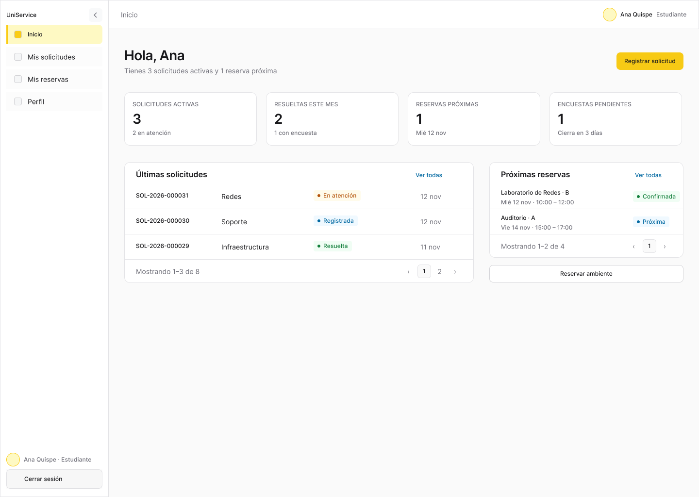

[Ver frame en Figma](https://www.figma.com/design/9qJJaiyMwZ1ZON36LkmbyR/GESTAL-V2?node-id=142-367)

P00 · Inicio del técnico

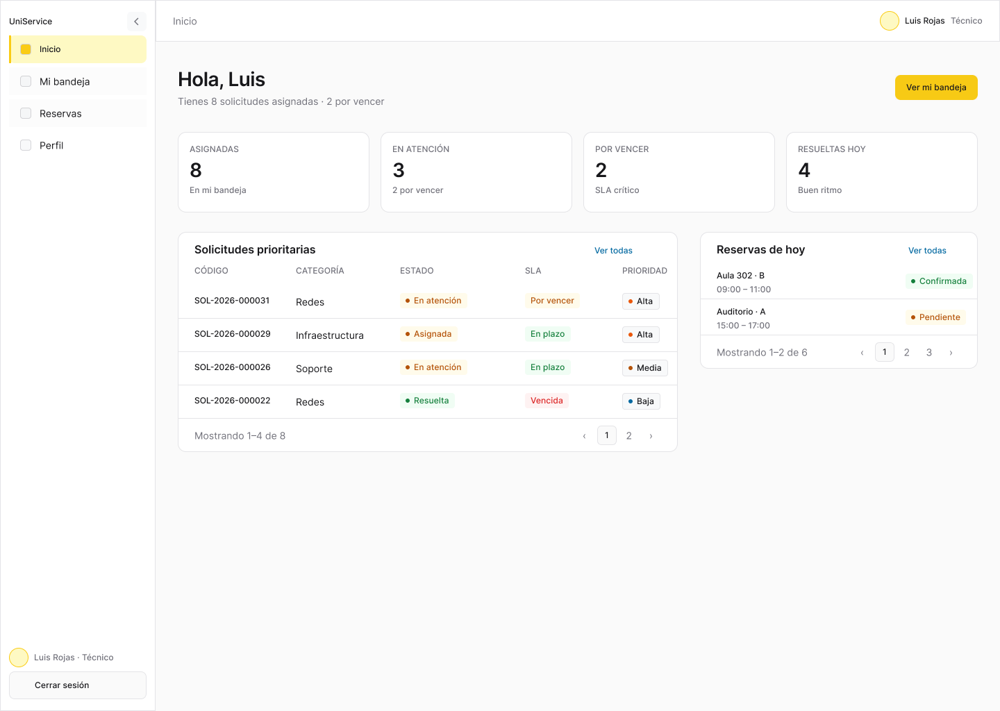

[Ver frame en Figma](https://www.figma.com/design/9qJJaiyMwZ1ZON36LkmbyR/GESTAL-V2?node-id=230-2)

P03 · Mis solicitudes

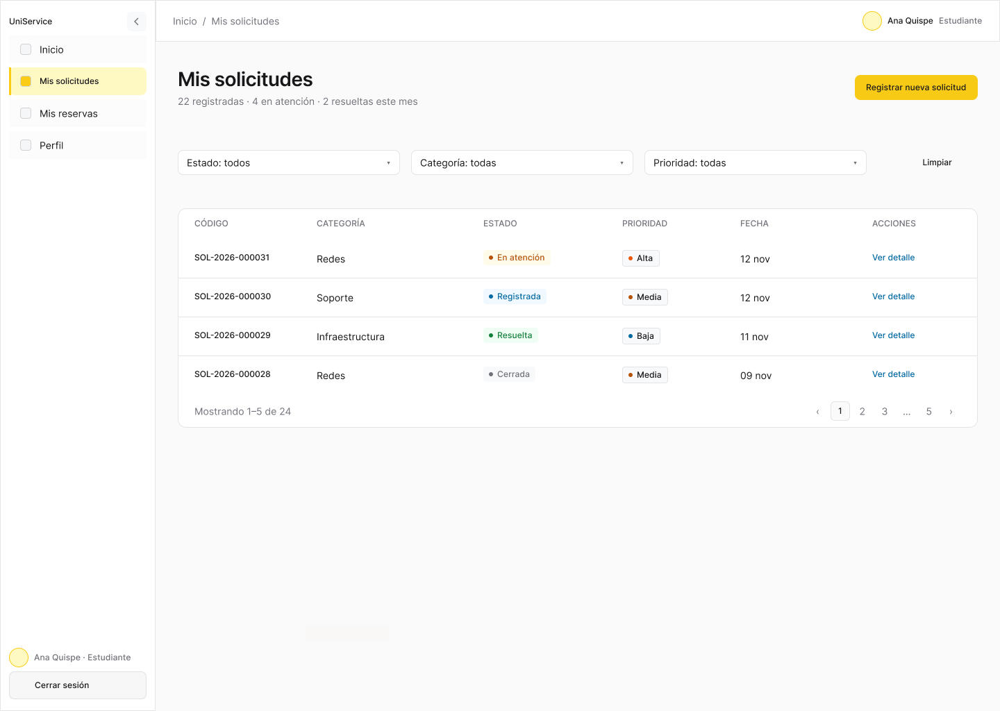

[Ver frame en Figma](https://www.figma.com/design/9qJJaiyMwZ1ZON36LkmbyR/GESTAL-V2?node-id=50-18)

P04 · Registrar solicitud

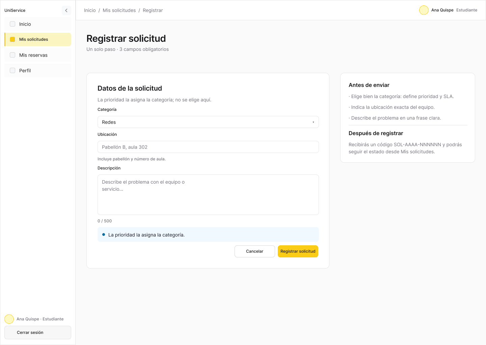

[Ver frame en Figma](https://www.figma.com/design/9qJJaiyMwZ1ZON36LkmbyR/GESTAL-V2?node-id=54-89)

P05 · Detalle para estudiante

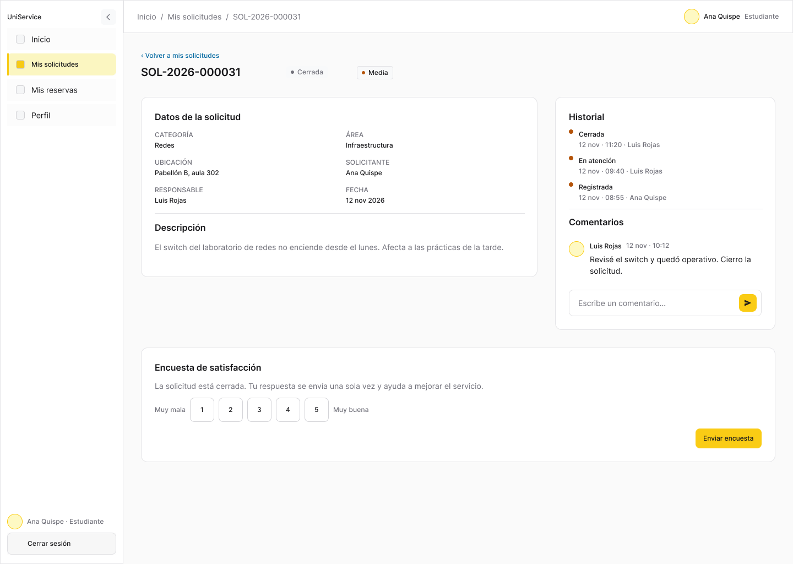

[Ver frame en Figma](https://www.figma.com/design/9qJJaiyMwZ1ZON36LkmbyR/GESTAL-V2?node-id=54-162)

P05b · Detalle para técnico

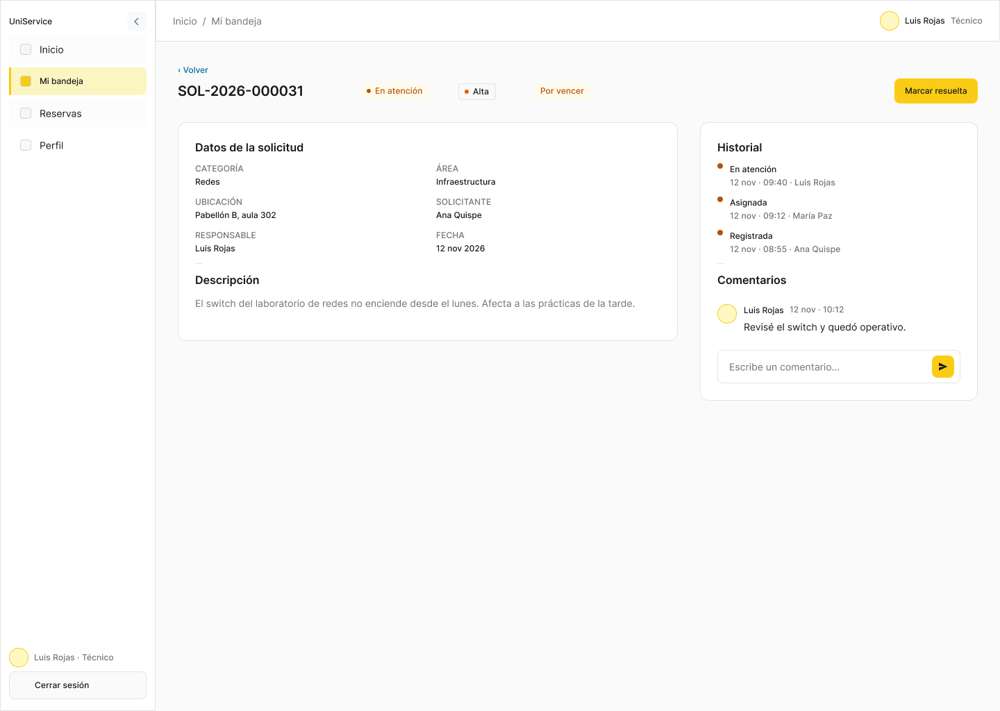

[Ver frame en Figma](https://www.figma.com/design/9qJJaiyMwZ1ZON36LkmbyR/GESTAL-V2?node-id=67-235)

P05c · Acciones del supervisor

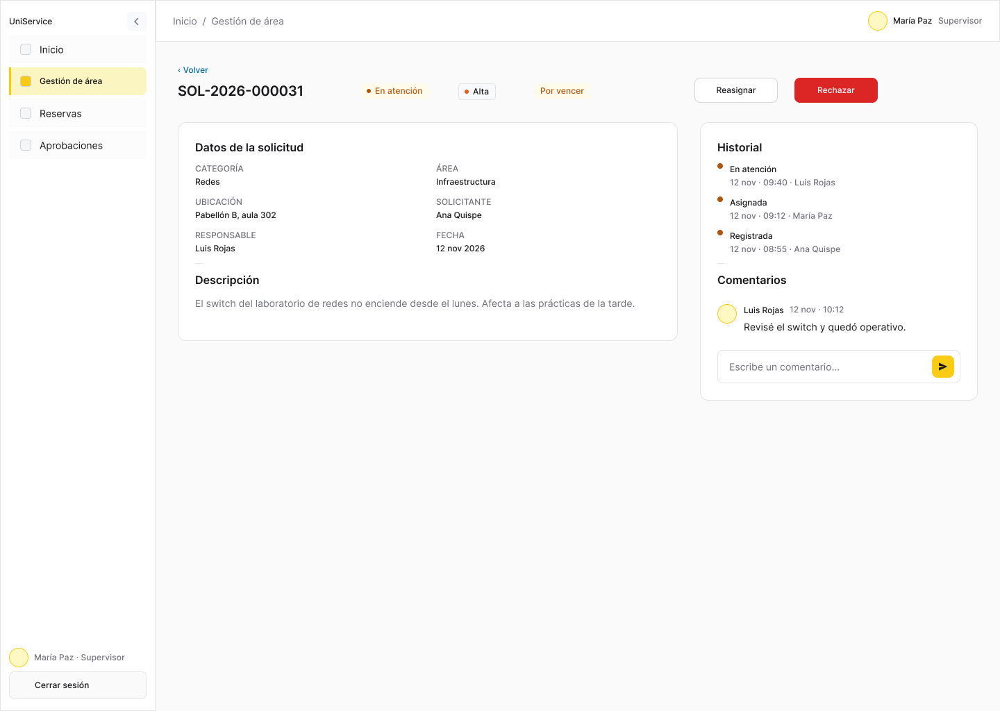

[Ver frame en Figma](https://www.figma.com/design/9qJJaiyMwZ1ZON36LkmbyR/GESTAL-V2?node-id=67-341)

P05c2 · Detalle de solicitud resuelta

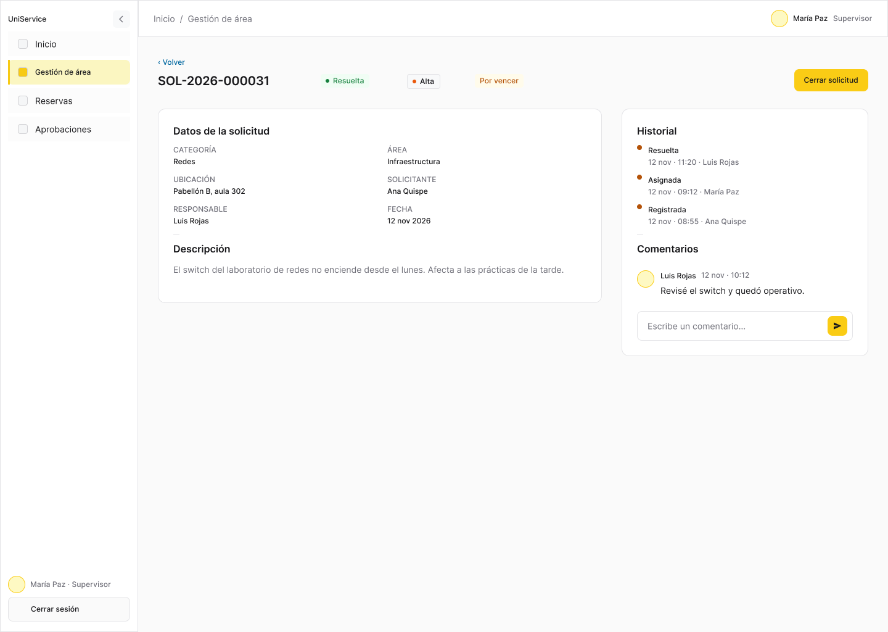

[Ver frame en Figma](https://www.figma.com/design/9qJJaiyMwZ1ZON36LkmbyR/GESTAL-V2?node-id=239-94)

P05d · Auditoría de la solicitud

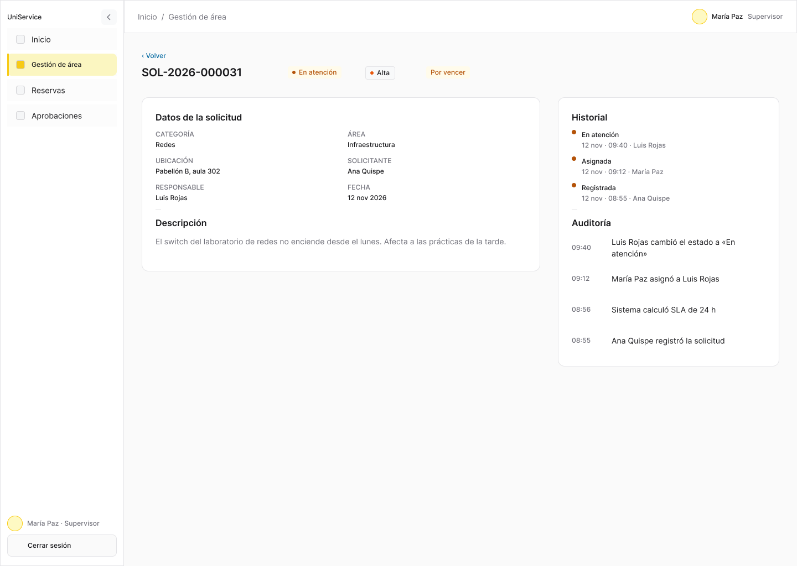

[Ver frame en Figma](https://www.figma.com/design/9qJJaiyMwZ1ZON36LkmbyR/GESTAL-V2?node-id=67-442)

P06 · Bandeja del técnico

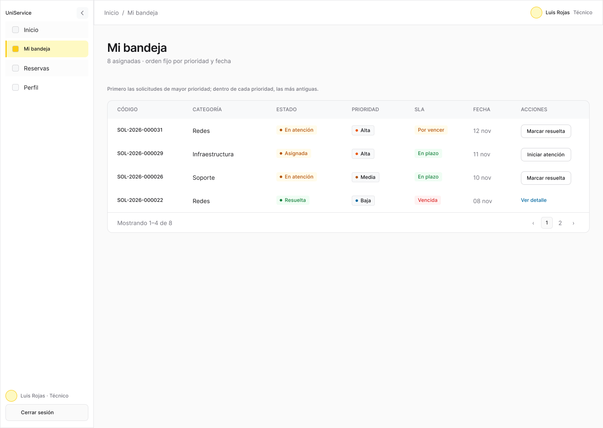

[Ver frame en Figma](https://www.figma.com/design/9qJJaiyMwZ1ZON36LkmbyR/GESTAL-V2?node-id=65-2)

P07 · Gestión de área

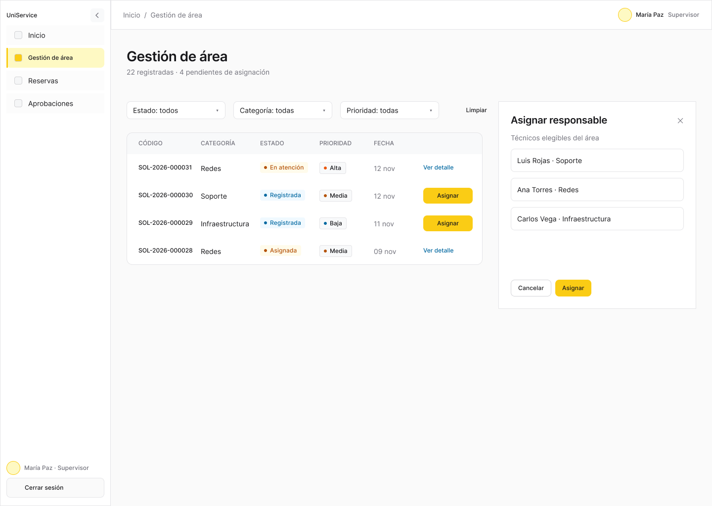

[Ver frame en Figma](https://www.figma.com/design/9qJJaiyMwZ1ZON36LkmbyR/GESTAL-V2?node-id=65-122)

P05 · Solicitud no encontrada

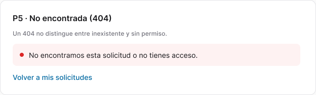

[Ver frame en Figma](https://www.figma.com/design/9qJJaiyMwZ1ZON36LkmbyR/GESTAL-V2?node-id=56-77)

P05 · Confirmación de rechazo

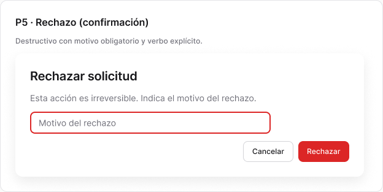

[Ver frame en Figma](https://www.figma.com/design/9qJJaiyMwZ1ZON36LkmbyR/GESTAL-V2?node-id=69-921)

