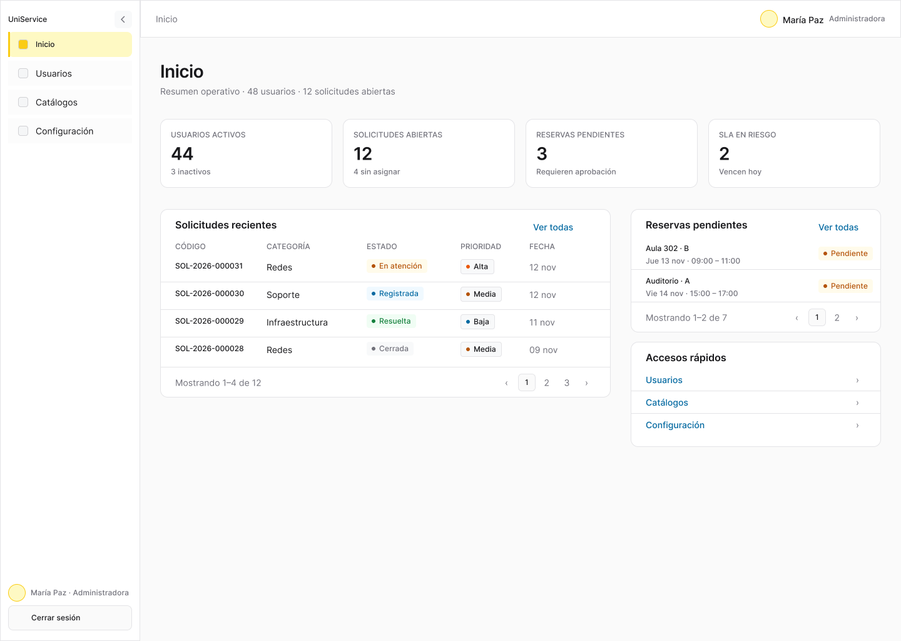
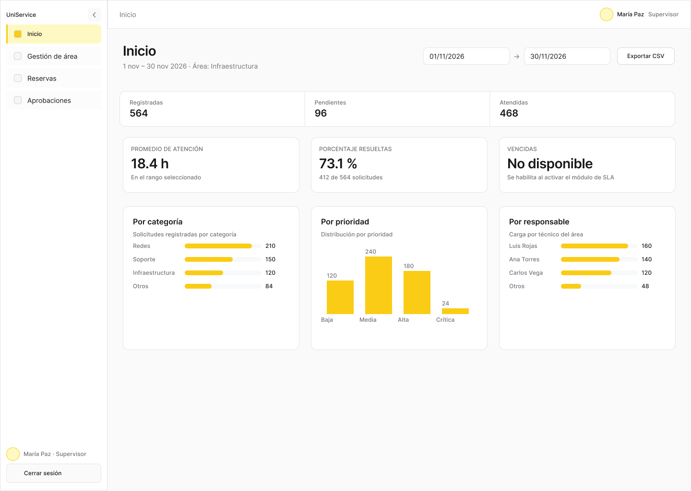
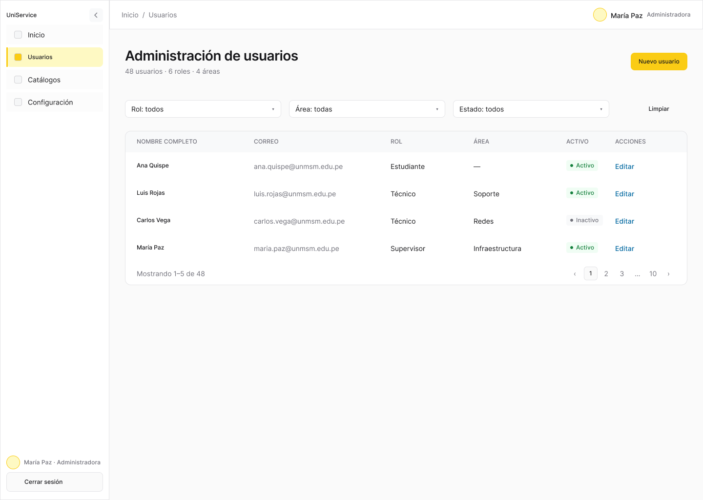
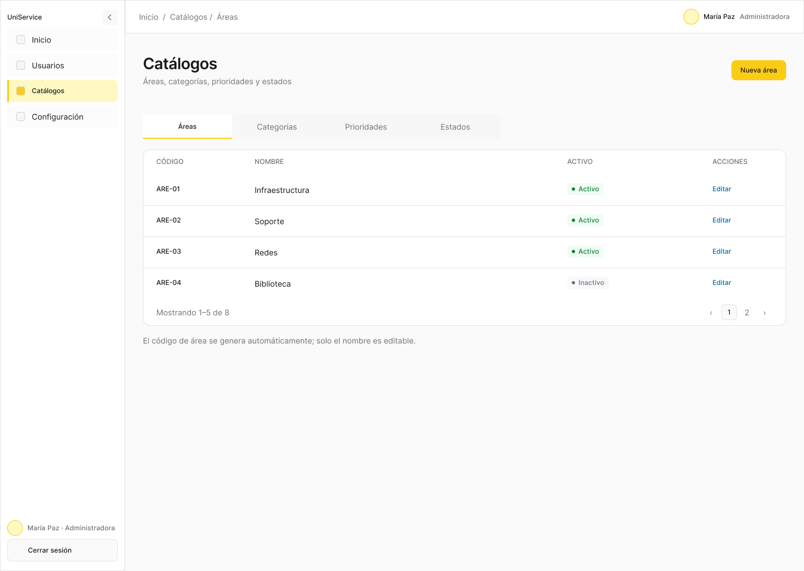
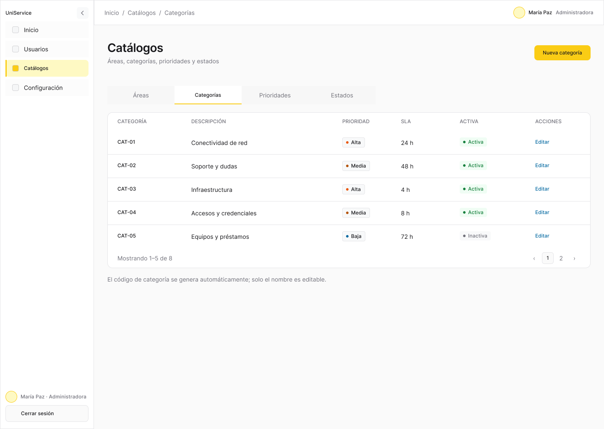
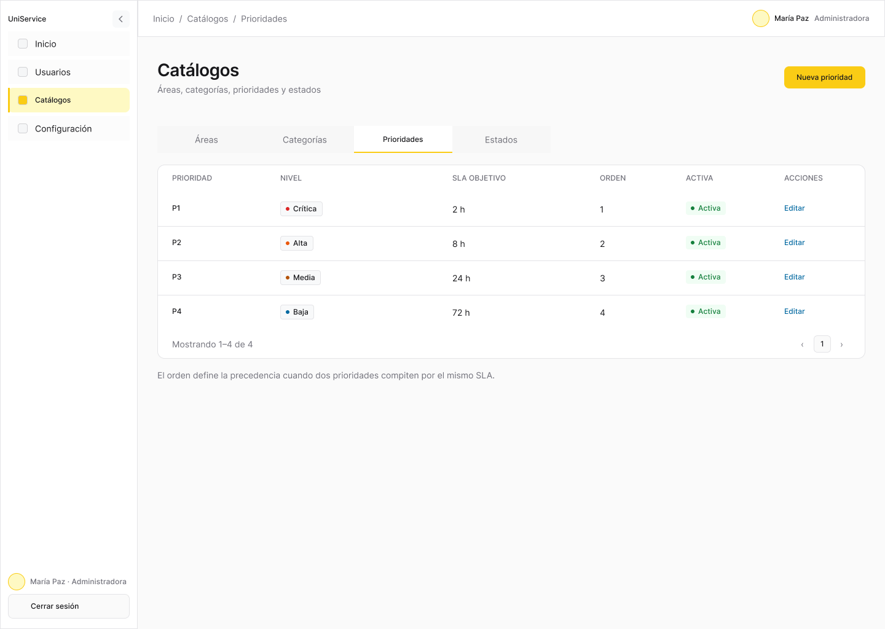
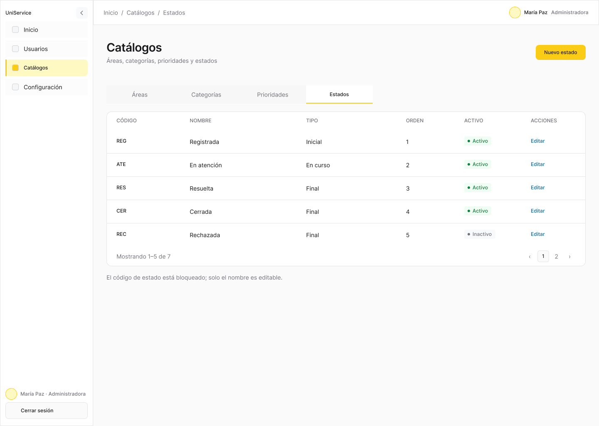
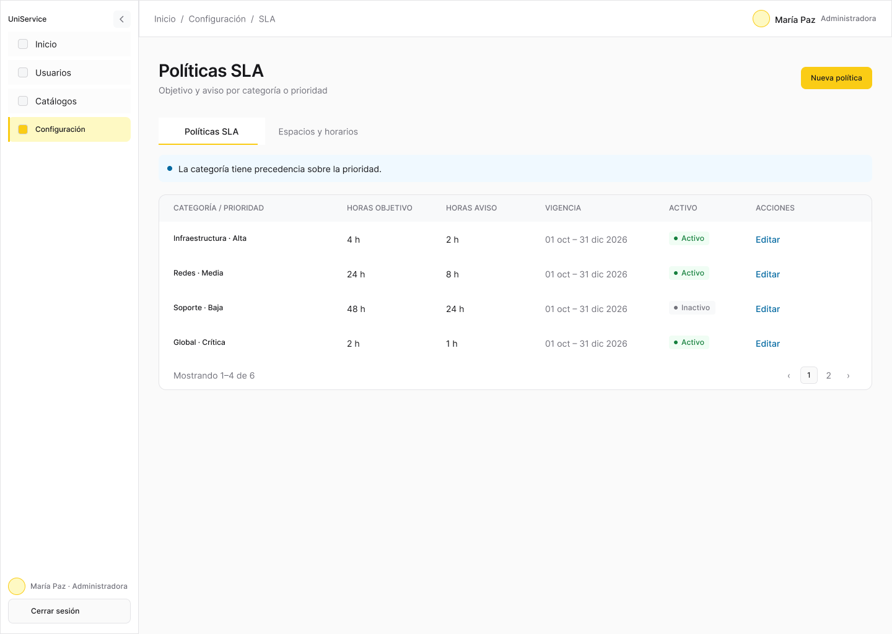

# Fase 04 · Indicadores, usuarios, catálogos y SLA

**Alcance.** HU-12 a HU-18. Depende de la [fase 02](02-acceso-sesion-y-perfil.md). Los recorridos con datos reales de solicitudes requieren la [fase 03](03-solicitudes-y-atencion.md).

**Fuentes.** [Dashboard](https://github.com/taller-web-sigesu/backend-uni/blob/main/docs/api/dashboard.md) · [Usuarios](https://github.com/taller-web-sigesu/backend-uni/blob/main/docs/api/usuarios.md) · [Catálogos](https://github.com/taller-web-sigesu/backend-uni/blob/main/docs/api/catalogos.md) · [SLA](https://github.com/taller-web-sigesu/backend-uni/blob/main/docs/api/calidad-servicio.md) · [P08 Indicadores](https://www.figma.com/design/9qJJaiyMwZ1ZON36LkmbyR/GESTAL-V2?node-id=66-134) · [Inicio administrador y P12–P14](https://www.figma.com/design/9qJJaiyMwZ1ZON36LkmbyR/GESTAL-V2?node-id=17-8)

## Tareas

- [ ] En `src/features/dashboard/`, implementar `/indicadores` con los nueve indicadores de `GET /dashboard/summary`. Usar el mes actual de Lima como rango inicial. Convertir los días elegidos a instantes UTC con inicio inclusivo y fin exclusivo. Separar el rango en edición del aplicado. Supervisor consulta su área y administrador elige un área o todas.
- [ ] Usar los valores de la API para tarjetas y agrupaciones. Presentar vencimientos como «No disponible» cuando corresponda y acompañar gráficos con etiquetas y valores. Descargar los CSV de solicitudes e indicadores desde `GET /dashboard/reports` con los mismos filtros aplicados al tablero.
- [ ] En `src/features/administration/`, implementar `/admin/usuarios` con listado, alta y edición. Exigir área para técnicos y supervisores; el rol Docente no lleva área y solo se crea desde aquí. Confirmar desactivación y mostrar el resultado de la API. Usar los contratos `/admin/users` y `/admin/roles`.
- [ ] Implementar `/admin/catalogos` con áreas, categorías, prioridades y estados, cada uno con sus operaciones de lectura y escritura autorizadas. En estados, permitir editar únicamente el nombre. Conservar las referencias históricas de los elementos desactivados.
- [ ] Implementar `/admin/sla` con `/admin/sla-policies`. En alta exigir categoría o prioridad. En edición conservar el alcance, explicar la precedencia de categoría y mostrar conflictos de vigencia junto al formulario.
- [ ] En el inicio del administrador, mostrar accesos a Indicadores, Usuarios, Catálogos, SLA y Reservas. Sustituir el listado global de solicitudes del mockup por esos accesos debido al alcance de `GET /requests`.

**Aceptación.** Verificar rango aplicado, exportación coherente, filtro fuera de alcance, desactivación de cuenta, edición de nombre de estado, datos históricos legibles y conflicto de vigencias SLA.

## Capturas de Figma

P00 · Inicio del administrador

[Ver frame en Figma](https://www.figma.com/design/9qJJaiyMwZ1ZON36LkmbyR/GESTAL-V2?node-id=143-233)

P08 · Indicadores

[Ver frame en Figma](https://www.figma.com/design/9qJJaiyMwZ1ZON36LkmbyR/GESTAL-V2?node-id=66-134)

P12 · Administración de usuarios

[Ver frame en Figma](https://www.figma.com/design/9qJJaiyMwZ1ZON36LkmbyR/GESTAL-V2?node-id=72-26)

P13 · Catálogo de áreas

[Ver frame en Figma](https://www.figma.com/design/9qJJaiyMwZ1ZON36LkmbyR/GESTAL-V2?node-id=73-59)

P13 · Catálogo de categorías

[Ver frame en Figma](https://www.figma.com/design/9qJJaiyMwZ1ZON36LkmbyR/GESTAL-V2?node-id=201-142)

P13 · Catálogo de prioridades

[Ver frame en Figma](https://www.figma.com/design/9qJJaiyMwZ1ZON36LkmbyR/GESTAL-V2?node-id=201-336)

P13 · Catálogo de estados

[Ver frame en Figma](https://www.figma.com/design/9qJJaiyMwZ1ZON36LkmbyR/GESTAL-V2?node-id=201-518)

P14 · Políticas SLA

[Ver frame en Figma](https://www.figma.com/design/9qJJaiyMwZ1ZON36LkmbyR/GESTAL-V2?node-id=73-157)

