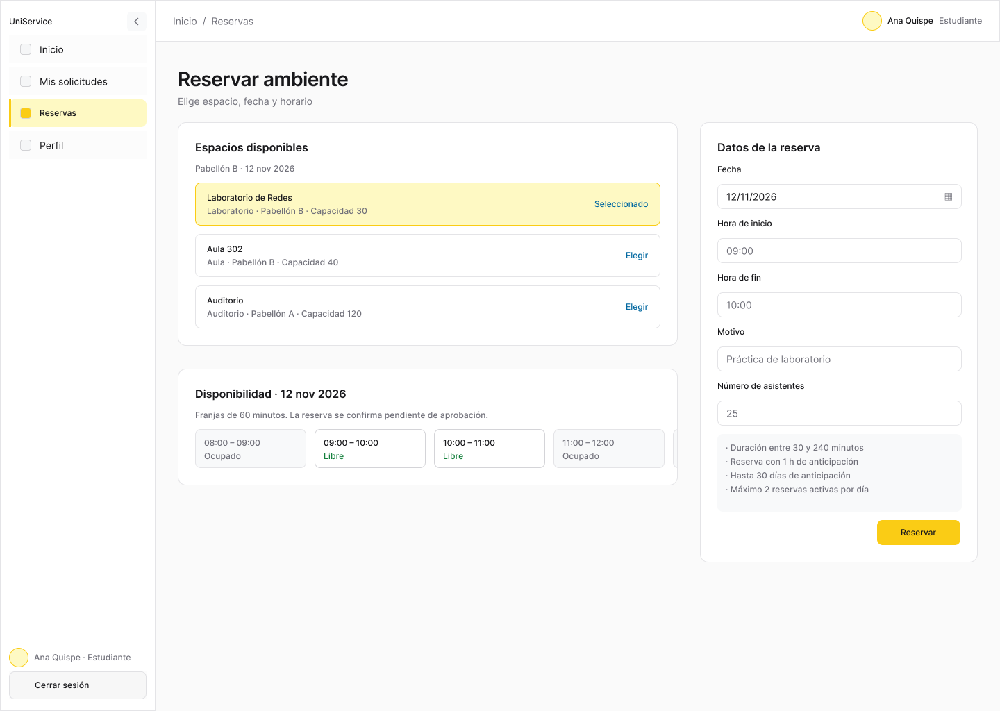
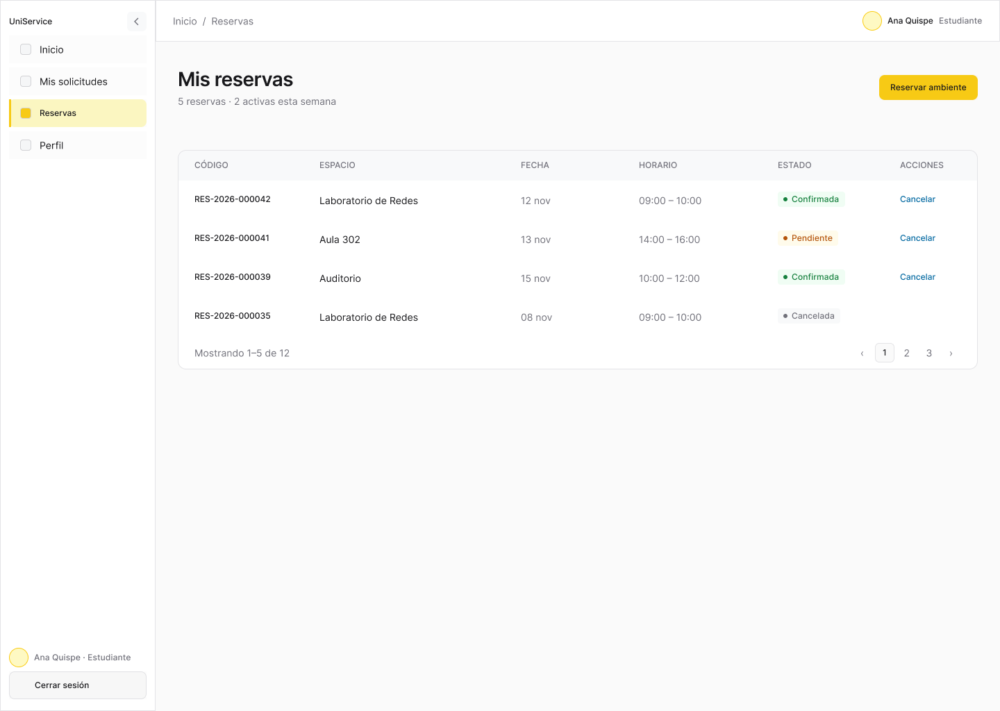
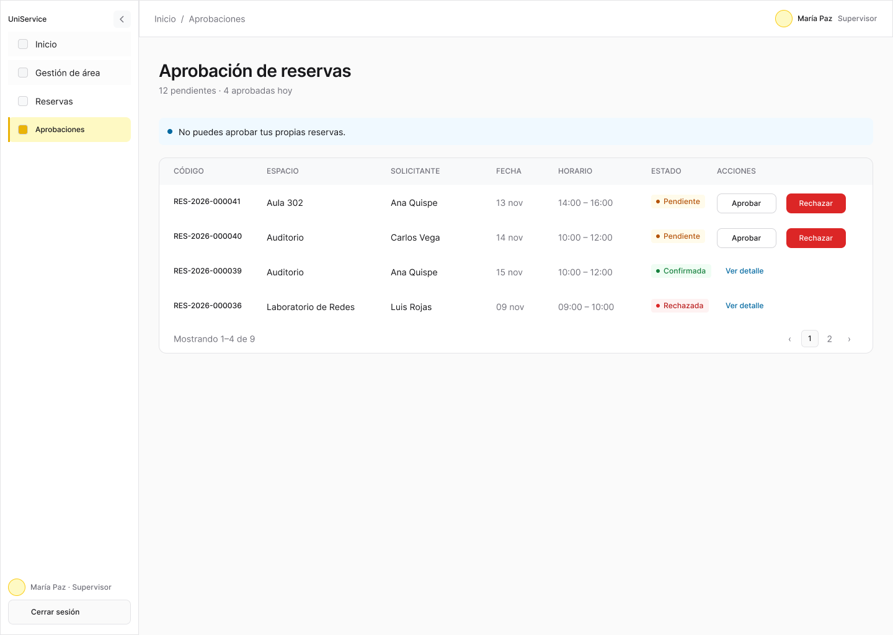
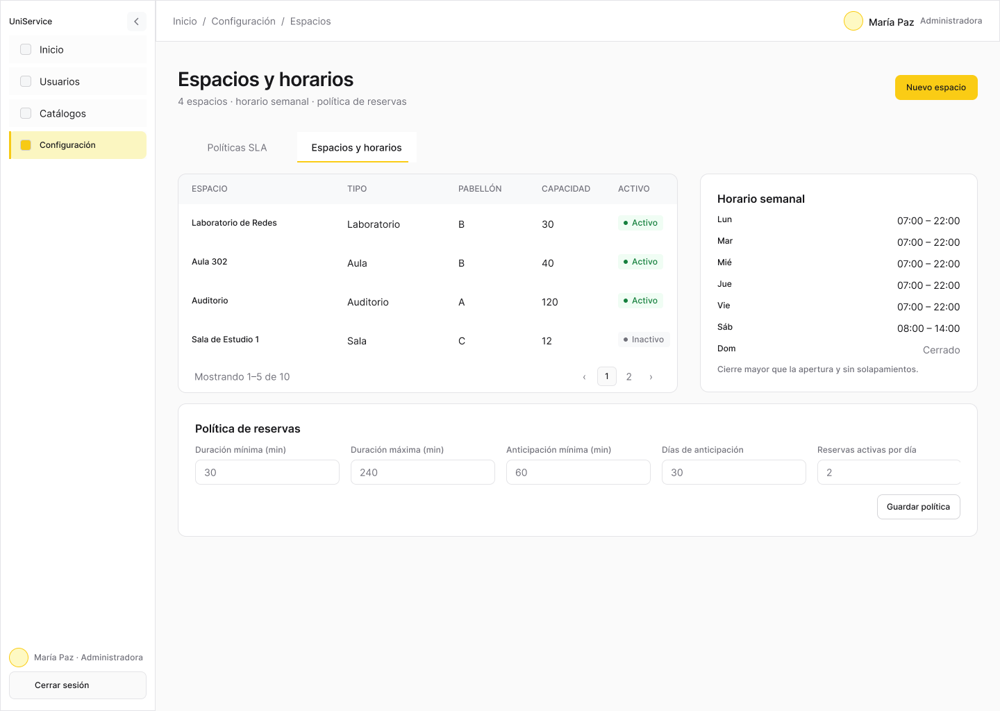
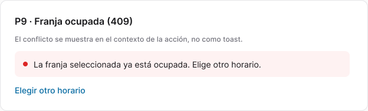

# Fase 05 · Reservas y administración de ambientes — Plan de implementación

> **Para agentes:** SUB-SKILL OBLIGATORIA: usar superpowers:subagent-driven-development (recomendado) o superpowers:executing-plans para ejecutar este plan tarea por tarea. Los pasos usan casillas (`- [ ]`) para el seguimiento.

**Objetivo:** implementar la consulta de espacios y disponibilidad, el registro de reservas, mis reservas con cancelación, la aprobación por supervisor o administrador y la administración de ambientes, horarios y política (HU-21 a HU-25).

**Arquitectura:** un adaptador `reservationsApi.js` para las rutas de usuario y otro `spacesAdminApi.js` para `/admin/spaces*`, `/admin/space-types` y `/admin/reservation-policy`. Las fechas y horas de reserva viajan como texto de Lima (`YYYY-MM-DD`, `HH:mm`) sin convertirse a `Date`. Las reglas de visibilidad de acciones (cancelar y aprobar) son funciones puras.

**Tecnologías:** las de la fase 01.

**Especificación:**
- HU-21 a HU-25 en `../infra-uni/docs/requirements/user-stories/EP-07-Reserva-Ambientes/`.
- `../backend-uni/docs/api/reservas.md`.
- Figma: [P09 Nueva reserva](https://www.figma.com/design/9qJJaiyMwZ1ZON36LkmbyR/GESTAL-V2?node-id=69-187), [P10 Mis reservas](https://www.figma.com/design/9qJJaiyMwZ1ZON36LkmbyR/GESTAL-V2?node-id=69-292), [P11 Aprobación](https://www.figma.com/design/9qJJaiyMwZ1ZON36LkmbyR/GESTAL-V2?node-id=70-611), [P15 Administración](https://www.figma.com/design/9qJJaiyMwZ1ZON36LkmbyR/GESTAL-V2?node-id=74-148) y la galería al final.
- Depende de la [fase 02](02-acceso-sesion-y-perfil.md). Completa la sección de reservas del inicio creada en la fase 01. Versión anterior: commit `46f8cf9`.

## Restricciones globales

Rigen las de la [fase 01](01-base-visual-y-api-simulada.md#restricciones-globales-aplican-a-las-seis-fases). Además:

- Estados: `PENDIENTE`, `CONFIRMADA`, `RECHAZADA`, `CANCELADA`.
- Alta: `espacioId`, `fecha`, `horaInicio`, `horaFin` y `motivo` obligatorios; `numAsistentes` opcional y positivo. Duración, anticipación y límite diario los valida el servidor; la pantalla dice «La política vigente de reservas se valida al enviar.»
- Cancelar: solo el propietario, con estado `PENDIENTE` o `CONFIRMADA` y antes del inicio (comparar `fecha` + `horaInicio` con la hora actual de Lima). Confirmación obligatoria.
- Decidir: `SUPERVISOR` o `ADMINISTRADOR` sobre pendientes de `GET /reservations?vista=gestion`; rechazar exige `motivo`; aprobar no se ofrece si `solicitanteId === usuario.id` (el servidor también lo impide con `403`).
- Horario de un espacio: una franja por día (`diaSemana` 1 = lunes … 7 = domingo); cierre posterior a apertura; los días omitidos quedan cerrados.
- Política: `duracionMinimaMinutos` > 0, `duracionMaximaMinutos` ≥ mínima, `horasAnticipacionMinima` ≥ 0, `diasAnticipacionMaxima` ≥ 0 y `maxReservasActivasPorDia` > 0. `404` en `GET` significa «Todavía no hay una política vigente».
- Textos de HU: «Registrar reserva», «Reserva registrada, pendiente de aprobación», «No hay disponibilidad para la fecha seleccionada», «Cancelar reserva», «Aprobar», «Rechazar».
- Conflicto de franja (`409` en alta o al aprobar): «La franja elegida ya no está disponible. Elige otra.»

## Foco de revisión

1. **Conflicto entre consultar y guardar.** Otra persona ocupa la franja: un `409` conserva motivo y asistentes, recarga la disponibilidad y pide otra franja. Prueba `NewReservationPage › conserva datos y recarga tras 409` (tarea 2).
2. **Cancelar una reserva que ya empezó.** El botón no aparece pasada la hora de inicio de Lima, aunque el navegador esté en otra zona horaria. Prueba `canCancel › usa la hora de Lima` (tarea 1).
3. **Autoaprobación.** Un supervisor que también reservó no ve «Aprobar» en su propia reserva. Prueba `ApprovalPage › no ofrece aprobar la propia reserva` (tarea 4).
4. **Espacio cerrado el día elegido.** Las franjas libres están vacías: se muestra «No hay disponibilidad para la fecha seleccionada» y no se puede enviar. Prueba `NewReservationPage › día cerrado sin franjas` (tarea 2).
5. **Error del servidor al guardar el horario.** El formulario conserva todas las franjas editadas. Prueba `SpacesAdminPage › conserva el horario tras un 400` (tarea 5).

---

## Estructura de archivos

```text
src/features/reservations/reservationsApi.js
src/features/reservations/reservationRules.js     # canCancel, canApprove, slotFits
src/features/reservations/NewReservationPage.jsx
src/features/reservations/MyReservationsPage.jsx
src/features/reservations/ReservationDetailPage.jsx
src/features/reservations/ApprovalPage.jsx
src/features/reservations/useSpaceNames.js        # id → nombre desde GET /spaces
src/features/administration/spacesAdminApi.js
src/features/administration/spaces/SpacesAdminPage.jsx
src/features/administration/spaces/ScheduleEditor.jsx
src/features/administration/spaces/PolicyForm.jsx
src/features/home/ReservationsPreview.jsx         # creada vacía en fase 01
src/mocks/handlers/reservations.js
```

---

### Tarea 1: Adaptadores, reglas y mocks de reservas

**Archivos:**
- Crear: `src/features/reservations/reservationsApi.js`, `reservationRules.js`, `useSpaceNames.js`, `src/features/administration/spacesAdminApi.js`, `src/mocks/handlers/reservations.js`
- Modificar: `src/mocks/db.js` (4 espacios de 2 tipos, uno sin horario el domingo, reservas en los cuatro estados, una del supervisor de TI, política vigente), `src/mocks/handlers/index.js`
- Prueba: `src/features/reservations/reservationsApi.test.js`, `src/features/reservations/reservationRules.test.js`

**Interfaces:**
- Consume: `request`, `todayInLima` (fase 01).
- Produce:
  - `listSpaces({ tipoEspacioId, pabellon, capacidadMinima, fecha, page })`, `getAvailability(espacioId, fecha)`, `createReservation(data)`, `listReservations({ vista, estado, fechaDesde, fechaHasta, page })`, `getReservation(id)`, `listReservationHistory(id)`, `changeReservationStatus(id, { estado, motivo })`.
  - `spacesAdminApi`: `listAreas`, `listSpaces`, `createSpace`, `updateSpace`, `listSpaceTypes`, `createSpaceType`, `updateSpaceType`, `getSchedule(id)`, `putSchedule(id, franjas)`, `getPolicy()`, `putPolicy(data)`.
  - `useSpaceNames() -> { spaceName(id), spaceTypes: [{id, nombre}] }`: lee `GET /spaces` con `size=100`; tipos únicos derivados de `items[].tipo`; desconocido → «Espacio <id>».
  - `nowInLima() -> { fecha: 'YYYY-MM-DD', hora: 'HH:mm' }` (en `reservationRules.js`).
  - `canCancel(reserva, usuario, ahora = nowInLima())`, `canApprove(detalle, usuario)`, `slotFits(libres, horaInicio, horaFin) -> boolean`.
  - Mock: alta solapada → 409; autoaprobación → 403; cancelación por otro usuario → 403; cancelar después del inicio → 409; `vista=gestion` para estudiante → 403.

- [ ] **Paso 1: Crear la rama y escribir las pruebas**

```bash
git switch main && git pull && git switch -c feature/frontend-fase-05-reservas
```

```js
test('getAvailability envía la fecha tal cual', ...) // query fecha=2026-11-16
test('createReservation solapada devuelve 409', ...)
test('vista gestion para estudiante devuelve 403', ...)
test('canCancel solo propietario, pendiente o confirmada y antes del inicio', ...)
test('canCancel usa la hora de Lima', ...) // vi.setSystemTime('2026-11-16T14:30:00Z') = 09:30 Lima; reserva 2026-11-16 10:00 → true; 09:00 → false
test('canApprove impide la autoaprobación', ...)
test('slotFits exige que la franja quede dentro de una libre', ...) // libres [{08:00,10:00}] → 08:30–09:30 true, 09:30–10:30 false
```

- [ ] **Paso 2: Ejecutar**

Run: `npm test -- src/features/reservations`
Expected: FAIL.

- [ ] **Paso 3: Implementar** según Interfaces.

- [ ] **Paso 4: Verificar**

Run: el mismo comando.
Expected: 7 passed.

- [ ] **Paso 5: Commit**

```bash
git add src/features/reservations src/features/administration/spacesAdminApi.js src/mocks
git commit -m "feat(frontend): adaptadores, reglas y mocks de reservas"
```

---

### Tarea 2: Nueva reserva

**Archivos:**
- Crear: `src/features/reservations/NewReservationPage.jsx`, `src/features/reservations/index.js`
- Modificar: `src/app/routes.jsx`
- Prueba: `src/features/reservations/NewReservationPage.test.jsx`

**Interfaces:**
- Consume: `listSpaces`, `getAvailability`, `createReservation`, `slotFits`, `useSpaceNames`, `todayInLima`.
- Produce: `NewReservationPage` (`/reservas/nueva`, P09):
  - Filtros «Tipo de espacio», «Pabellón», «Capacidad mínima» y «Fecha» (por defecto `todayInLima()`); lista de espacios con tipo, pabellón, capacidad y horario del día.
  - Al elegir un espacio: franjas libres y ocupadas como lista con texto («08:00–10:00 libre»); «Hora de inicio» y «Hora de fin» (`input type=time step=900`) validadas con `slotFits`; «Motivo» obligatorio; «Asistentes (opcional)» entero positivo; botón «Registrar reserva».
  - Éxito: «Reserva registrada, pendiente de aprobación» con el código y enlace a «Ver mis reservas».
  - `409`: aviso de conflicto, conserva motivo y asistentes, limpia las horas y recarga la disponibilidad. `400` asocia `errores[].campo`.

- [ ] **Paso 1: Escribir las pruebas**

```jsx
test('filtra espacios y muestra su horario', ...)
test('muestra franjas libres y ocupadas como texto', ...)
test('no envía una franja fuera de las libres', ...)
test('registra y muestra el código pendiente', ...)
test('conserva datos y recarga tras 409', ...) // motivo y asistentes conservan su valor; GET availability llamado 2 veces
test('día cerrado sin franjas', ...)
test('asistentes debe ser positivo', ...)
```

- [ ] **Paso 2: Ejecutar**

Run: `npm test -- src/features/reservations/NewReservationPage.test.jsx`
Expected: FAIL.

- [ ] **Paso 3: Implementar** según Interfaces y P09.

- [ ] **Paso 4: Verificar**

Run: el mismo comando.
Expected: 7 passed.

- [ ] **Paso 5: Commit**

```bash
git add src/features/reservations src/app/routes.jsx
git commit -m "feat(frontend): registro de reserva con disponibilidad y conflicto de franja"
```

---

### Tarea 3: Mis reservas, detalle e inicio

**Archivos:**
- Crear: `src/features/reservations/MyReservationsPage.jsx`, `ReservationDetailPage.jsx`
- Modificar: `src/features/home/ReservationsPreview.jsx`, `src/app/routes.jsx`
- Prueba: `src/features/reservations/MyReservationsPage.test.jsx`

**Interfaces:**
- Consume: `listReservations`, `getReservation`, `listReservationHistory`, `changeReservationStatus`, `canCancel`, `useSpaceNames`, `RESERVATION_STATUS_LABELS`.
- Produce:
  - `MyReservationsPage` (`/reservas`, P10): filtros «Estado», «Desde» y «Hasta»; tabla con código, espacio, fecha, franja y estado; fila → `/reservas/:id`; botón «Registrar reserva».
  - `ReservationDetailPage` (`/reservas/:id`): espacio, franja, motivo, asistentes, motivo de rechazo si existe e historial; «Cancelar reserva» solo con `canCancel`, con confirmación; tras éxito recarga detalle e historial. `409` → «La reserva ya no se puede cancelar» y recarga.
  - `ReservationsPreview`: próximas 3 reservas propias (desde hoy) para `ESTUDIANTE`, `DOCENTE` y `TECNICO`.

- [ ] **Paso 1: Escribir las pruebas**

```jsx
test('lista mis reservas con nombre de espacio y estado', ...)
test('filtrar por estado vuelve a la página 0', ...)
test('cancelar pide confirmación y actualiza el estado', ...)
test('no ofrece cancelar una reserva rechazada o ajena', ...)
test('409 al cancelar recarga y avisa', ...)
test('el inicio muestra las próximas reservas', ...)
```

- [ ] **Paso 2: Ejecutar**

Run: `npm test -- src/features/reservations/MyReservationsPage.test.jsx`
Expected: FAIL.

- [ ] **Paso 3: Implementar** según Interfaces y P10.

- [ ] **Paso 4: Verificar**

Run: el mismo comando.
Expected: 6 passed.

- [ ] **Paso 5: Commit**

```bash
git add src/features/reservations src/features/home/ReservationsPreview.jsx src/app/routes.jsx
git commit -m "feat(frontend): mis reservas, detalle con cancelación y vista previa en el inicio"
```

---

### Tarea 4: Aprobación de reservas

**Archivos:**
- Crear: `src/features/reservations/ApprovalPage.jsx`
- Modificar: `src/app/routes.jsx`
- Prueba: `src/features/reservations/ApprovalPage.test.jsx`

**Interfaces:**
- Consume: `listReservations({ vista: 'gestion', estado: 'PENDIENTE' })`, `getReservation`, `getAvailability`, `changeReservationStatus`, `canApprove`, `useSession`.
- Produce: `ApprovalPage` (`/reservas/aprobacion`, P11): tabla de pendientes; al abrir una fila carga el detalle (`solicitanteId`, motivo, asistentes) y la disponibilidad del día; «Aprobar» solo con `canApprove`; «Rechazar» con «Motivo» obligatorio. Tras decidir, la fila sale de la lista. `409` → aviso de conflicto, recarga el detalle y la disponibilidad. `403` → «No puedes decidir sobre esta reserva».

- [ ] **Paso 1: Escribir las pruebas**

```jsx
test('lista pendientes de la vista de gestión', ...) // query vista=gestion&estado=PENDIENTE
test('aprobar envía CONFIRMADA y retira la fila', ...)
test('rechazar exige motivo', ...)
test('no ofrece aprobar la propia reserva', ...)
test('409 al aprobar recarga detalle y disponibilidad', ...)
```

- [ ] **Paso 2: Ejecutar**

Run: `npm test -- src/features/reservations/ApprovalPage.test.jsx`
Expected: FAIL.

- [ ] **Paso 3: Implementar** según Interfaces y P11.

- [ ] **Paso 4: Verificar**

Run: el mismo comando.
Expected: 5 passed.

- [ ] **Paso 5: Commit**

```bash
git add src/features/reservations/ApprovalPage.* src/app/routes.jsx
git commit -m "feat(frontend): aprobación y rechazo de reservas sin autoaprobación"
```

---

### Tarea 5: Administración de ambientes, horarios y política

**Archivos:**
- Crear: `src/features/administration/spaces/SpacesAdminPage.jsx`, `ScheduleEditor.jsx`, `PolicyForm.jsx`
- Modificar: `src/app/routes.jsx`
- Prueba: `src/features/administration/spaces/SpacesAdminPage.test.jsx`

**Interfaces:**
- Consume: `spacesAdminApi`, incluido `listAreas()` (`GET /admin/catalogs/areas?size=100`), que vive aquí para no depender de la fase 04.
- Produce:
  - `SpacesAdminPage` (`/admin/ambientes`, P15): pestañas «Espacios», «Tipos de espacio» y «Política de reservas».
  - Espacios: tabla con código, nombre, tipo, pabellón, capacidad y estado; formulario con `codigo` (solo en el alta), `nombre`, `tipoEspacioId`, `capacidad` (> 0), `areaId`, `pabellon`, `piso`, `descripcion`, `ubicacionDetallada`; «Horario» abre `ScheduleEditor`.
  - `ScheduleEditor({ spaceId })`: siete filas (lunes a domingo) con casilla «Abierto», «Apertura» y «Cierre»; valida cierre > apertura; envía con `PUT` solo los días abiertos como `{ diaSemana, horaApertura, horaCierre }`; un error conserva lo editado.
  - Tipos de espacio: tabla y formulario `codigo`, `nombre`, `descripcion`, con baja lógica.
  - `PolicyForm`: los cinco campos de las Restricciones con validación local; `404` inicial → formulario vacío con «Todavía no hay una política vigente».

- [ ] **Paso 1: Escribir las pruebas**

```jsx
test('crea un espacio con aforo positivo', ...)
test('el horario envía solo días abiertos con diaSemana 1 a 7', ...) // lunes y miércoles → franjas [{diaSemana:1,...},{diaSemana:3,...}]
test('rechaza cierre anterior o igual a la apertura', ...)
test('conserva el horario tras un 400', ...)
test('la política valida máximo mayor o igual al mínimo', ...)
test('sin política vigente muestra el formulario vacío', ...)
```

- [ ] **Paso 2: Ejecutar**

Run: `npm test -- src/features/administration/spaces`
Expected: FAIL.

- [ ] **Paso 3: Implementar** según Interfaces y P15.

- [ ] **Paso 4: Verificar**

Run: `npm test && npm run lint && npm run build`
Expected: todo en verde.

- [ ] **Paso 5: Verificación visual**

Run: `npm run dev:mock`; recorrer alta, conflicto, cancelación, aprobación y administración con Ana, el supervisor de TI y el administrador, a 360 y 1440 px.
Expected: coincide con P09 a P11 y P15.

- [ ] **Paso 6: Commit**

```bash
git add src/features/administration/spaces src/app/routes.jsx
git commit -m "feat(frontend): administración de ambientes, horarios y política de reservas"
```

---

## Aceptación de la fase

- [ ] Alta pendiente, aprobación, rechazo sin motivo, cancelación, conflicto de franja, intento de autoaprobación, intento de cancelación por otro usuario y cambio de política, cubiertos por pruebas en verde.

## Capturas de Figma

<details>
<summary>P09 · Reservar ambiente</summary>



[Ver frame en Figma](https://www.figma.com/design/9qJJaiyMwZ1ZON36LkmbyR/GESTAL-V2?node-id=69-187)

</details>

<details>
<summary>P10 · Mis reservas</summary>



[Ver frame en Figma](https://www.figma.com/design/9qJJaiyMwZ1ZON36LkmbyR/GESTAL-V2?node-id=69-292)

</details>

<details>
<summary>P11 · Aprobación de reservas</summary>



[Ver frame en Figma](https://www.figma.com/design/9qJJaiyMwZ1ZON36LkmbyR/GESTAL-V2?node-id=70-611)

</details>

<details>
<summary>P15 · Administración de ambientes</summary>



[Ver frame en Figma](https://www.figma.com/design/9qJJaiyMwZ1ZON36LkmbyR/GESTAL-V2?node-id=74-148)

</details>

<details>
<summary>P09 · Conflicto de franja horaria</summary>



[Ver frame en Figma](https://www.figma.com/design/9qJJaiyMwZ1ZON36LkmbyR/GESTAL-V2?node-id=69-913)

</details>
